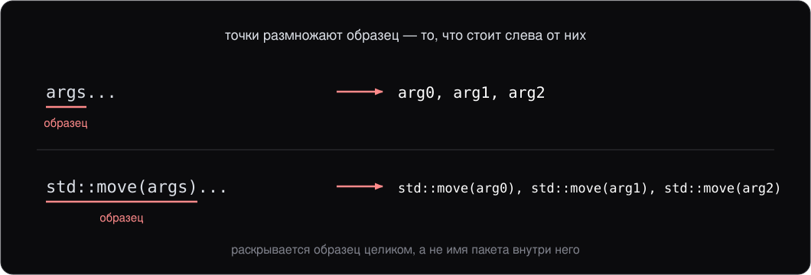
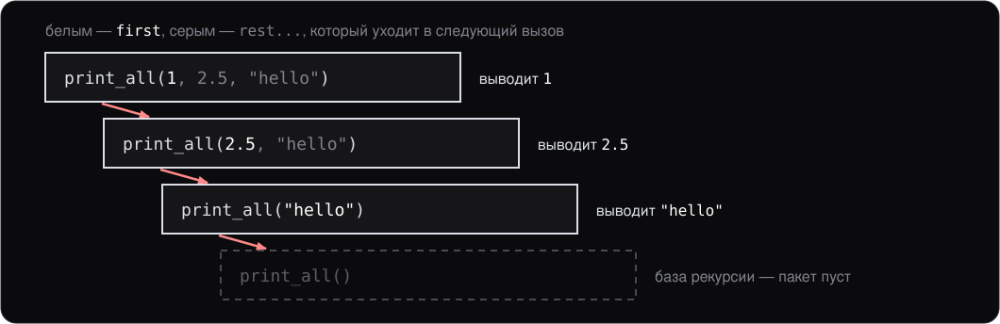
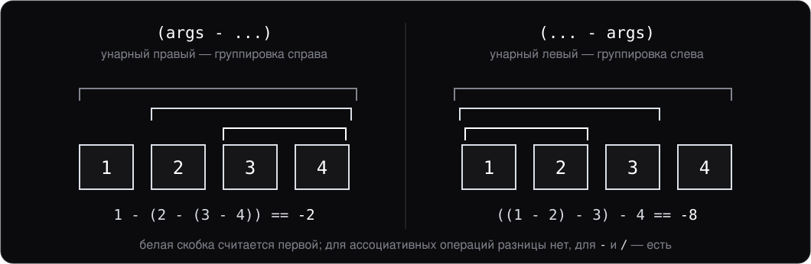

# Лекция 9. Variadic templates и правила вывода типов

> Конспект к лекции для самостоятельного чтения. Слайды (`slides.md`) повторяют структуру, конспект подробнее объясняет «почему».

## 0. О чём эта лекция

Это вторая лекция про шаблоны. На прошлой мы научились их **читать и писать** — обычные template-функции и классы, [специализацию](../glossary.md#specialization) (specialization), перегрузку, [зависимые имена](../glossary.md#dependent-name) (dependent names). Сегодня — две вещи, которые делают шаблоны полноценным механизмом для современного C++:

- **Variadic templates** — шаблоны, принимающие **любое число** параметров. Без них не было бы `std::tuple`, `std::variant`, `std::make_unique`, `std::format`.
- **Fold expressions (C++17)** — выразительный способ операции над пакетом параметров. Заменяет рекурсию по пакету на короткое выражение.

Заодно посмотрим на **правила вывода типов** — то, как именно компилятор определяет `T` по аргументу вызова. Это важно понимать, чтобы не путаться, когда ваш `T` оказался не тем, чего вы ждали. По тем же правилам работает `auto` в возвращаемом типе и в параметрах функции: первым курс пользуется с лекции 8, а объясняются оба здесь.

К концу лекции вы должны уметь написать свой `make_unique`-подобный factory, понимать `std::tuple` и `std::format` на уровне сигнатур и по виду параметра — `T`, `T&` или `const T&` — предсказать, каким выйдет `T`.

## 1. Variadic templates

Иногда функция должна принимать **любое количество** аргументов, возможно разного типа. Самый известный пример — `printf` в C:

```c
printf("Hello, %s, you are %d years old\n", name, age);
```

Это работает, но без типобезопасности — если форматная строка не совпадает с типами, в лучшем случае получаем мусор в выводе, в худшем — [UB](../glossary.md#ub) (undefined behavior). C++ хочет тот же гибкий интерфейс, но с проверкой типов на компиляции. Для этого в C++11 ввели **[variadic templates](../glossary.md#variadic)** (по-русски — шаблоны с переменным числом параметров).

На variadic templates построено очень многое в стандартной библиотеке: `std::tuple`, `std::variant`, `std::make_unique`/`make_shared`, `std::format`/`std::print`, `std::invoke`, всё семейство emplace-функций контейнеров. Это не «экзотическая» фича — это рабочий механизм современного C++.

### Синтаксис

```cpp
template <typename... Ts>
void print_all(Ts... args);
```

Несколько ключевых терминов:

- `typename... Ts` — **[пакет параметров шаблона](../glossary.md#parameter-pack)** (template parameter pack). Это последовательность из нуля или более типов.
- `Ts... args` — **пакет параметров функции** (function parameter pack). Соответствующие значения.
- `args...` — **[раскрытие пакета](../glossary.md#pack-expansion)** (pack expansion). Точки **после** того, что нужно «размножить».

![Две строки ячеек: типы Ts — int, double, const char*, под ними значения args — 1, 2.5, "x"; скобка под ними подписана sizeof...(args) == 3; справа перечёркнутое args[0]](img/parameter-pack.svg)

Работать с пакетом можно только через раскрытие, рекурсию или [fold expression](../glossary.md#fold) (по-русски — выражение свёртки).

### `sizeof...`

Узнать число элементов в пакете:

```cpp
template <typename... Ts>
void f(Ts... args) {
    std::print("Got {} args\n", sizeof...(args));
}

f();              // 0
f(1, 2.0);        // 2
f(1, 2.0, "x");   // 3
```

`sizeof...(args)` — отдельный оператор. Не путайте с `sizeof(args)`, у которого совсем другая семантика.

## 2. Раскрытие пакета

Пакет можно раскрыть в **разные контексты** — везде, где синтаксически уместен «список через запятую»:

```cpp
template <typename... Ts>
void forward_all(Ts... args) {
    other_func(args...);                    // в список аргументов
}

template <typename... Ts>
auto make_array(Ts... args) {
    return std::array{args...};             // в initializer list
}

template <typename... Bases>
class Multi : public Bases... {             // в список баз класса
    // ...
};
```

Раскрытие — это синтаксическое «применение тройной точки» к тому, что слева. `args...` означает «получи последовательность через запятую: `arg0, arg1, ..., argN`».

Точки `...` ставятся **после** **образца** (pattern) раскрытия — того выражения или типа, которое нужно «применить к каждому элементу пакета»:



## 3. Классическая рекурсия по пакету

До C++17 единственный способ обработать каждый элемент пакета по отдельности — рекурсия:

```cpp
void print_all() {}      // база рекурсии — пустой пакет

template <typename T, typename... Rest>
void print_all(T first, Rest... rest) {
    std::cout << first << ' ';
    print_all(rest...);  // рекурсивный вызов с остатком
}

print_all(1, 2.5, "hello");    // 1 2.5 hello
```



### `if constexpr`: база рекурсии без второй функции

Отдельная функция для пустого пакета нужна только затем, чтобы остановить рекурсию. Напрашивается проверить размер остатка прямо в теле:

```cpp
if (sizeof...(rest) > 0) {   // CE
    print_all(rest...);
}
```

Не компилируется. `sizeof...(rest)` известен на компиляции, но обычный `if` — конструкция времени выполнения: **обе** его ветки обязаны быть корректными. Для последнего элемента остаток пуст, компилятор всё равно должен скомпилировать вызов `print_all()` без аргументов — а такой [перегрузки](../glossary.md#overload) (overload) больше нет.

`if constexpr` (C++17) снимает именно это ограничение: условие вычисляется на компиляции, и **невыбранная ветка не инстанцируется** — при [инстанцировании](../glossary.md#instantiation) (instantiation) шаблона компилятор её отбрасывает.

```cpp
template <typename T, typename... Rest>
void print_all(T first, Rest... rest) {
    std::cout << first << ' ';
    if constexpr (sizeof...(rest) > 0) {
        print_all(rest...);            // для пустого остатка ветки просто нет
    }
}

print_all(1, 2.5, "hello");            // 1 2.5 hello
```

База рекурсии исчезла: при инстанцировании `print_all<const char*>` рекурсивного вызова нет вообще.

**Правило:** `if constexpr` нужен там, где ветки предъявляют **разные требования к типу**, то есть в шаблоне. Шаблон при этом не обязательно начинается словом `template`: лямбда с параметром `auto` (лекция 10) и функция с параметром `auto` ([раздел 6](#auto-в-параметрах-c20)) — тоже шаблоны, и `if constexpr` в них работает так же.

### `if constexpr` вне шаблона

Вне шаблона инстанцировать нечего, поэтому отброшенная ветка всё равно проверяется целиком: имена в ней обязаны быть объявлены, выражения — корректны. От обычного `if` с константным условием остаётся одно заметное отличие — `return` в отброшенной ветке не участвует в [выводе возвращаемого типа](#вывод-возвращаемого-типа-c14):

```cpp
constexpr bool kVerbose = false;

auto describe(int pid) {
    if constexpr (kVerbose) {
        return std::format("process {}", pid);   // std::string
    } else {
        return pid;                               // int
    }
}
```

С обычным `if` это [CE](../glossary.md#ce) (compilation error): два `return` с разными типами. С `if constexpr` первая ветка отброшена, и функция возвращает `int`.

Отсюда и граница, где `if constexpr` заменяет `#ifdef`. Флаг сборки, при котором код обеих веток компилируется, — да. Платформенный код — нет:

```cpp
constexpr bool kLinux = false;

if constexpr (kLinux) {
    epoll_create1(0);   // CE на Windows: имя не объявлено, хотя ветка отброшена
}
```

Функции, которой на этой системе нет, компилятор не простит и в отброшенной ветке. Здесь остаётся `#ifdef`: препроцессор (лекция 1) убирает текст раньше, чем компилятор его увидит.

Рекурсия в любом варианте инстанцирует по функции на каждый суффикс пакета, и на каждом шаге повторяется одно и то же. С C++17 для большинства таких задач рекурсия не нужна вовсе — есть fold expressions.

## 4. Fold expressions (C++17)

Fold expression — это синтаксис, чтобы **свернуть** пакет в одно значение через бинарный оператор. Аналог `reduce`/`fold` из функциональных языков.

### Базовый пример

```cpp
template <typename... Ts>
auto sum(Ts... args) {
    return (args + ...);
}

sum(1, 2, 3, 4);    // 10
```

`(args + ...)` — **унарный правый fold** по оператору `+`. Компилятор раскрывает его в:

```cpp
arg1 + (arg2 + (arg3 + arg4))
```

То есть применяет оператор справа налево по парам.

### Четыре формы

| Форма | Раскрытие |
|---|---|
| `(args op ...)` | `arg1 op (arg2 op (... op argN))` — унарный правый |
| `(... op args)` | `((arg1 op arg2) op ...) op argN` — унарный левый |
| `(args op ... op init)` | то же, что унарный правый, плюс `init` справа — бинарный правый |
| `(init op ... op args)` | то же, что унарный левый, плюс `init` слева — бинарный левый |



Унарные формы требуют, чтобы пакет был **непустым**. Бинарные позволяют задать начальное значение для пустого случая.

### Практические примеры

```cpp
template <typename... Ts>
auto sum(Ts... args)         { return (args + ...); }

template <typename... Ts>
bool all_true(Ts... args)    { return (args && ...); }

template <typename... Ts>
bool any_true(Ts... args)    { return (args || ...); }
```

Особенно полезен **fold по запятой**:

```cpp
template <typename... Ts>
void print_all(Ts... args) {
    ((std::cout << args << ' '), ...);    // fold по ,
}

print_all(1, 2.5, "hello");    // 1 2.5 hello
```

`((expr), ...)` — стандартная идиома «вычислить выражение для каждого элемента пакета». Это часто заменяет рекурсию.

Бинарные формы с пустым пакетом:

```cpp
template <typename... Ts>
int sum(Ts... args) {
    return (0 + ... + args);    // sum() == 0, sum(1,2,3) == 6
}
```

С `init = 0` функция работает даже если пакет пустой.

### Цикл по пакету: `template for` (C++26)

Fold по запятой обрабатывает каждый элемент одним выражением. Когда на элемент нужно несколько операторов — завести переменную, поставить `if`, — выражения мало, и его приходится выносить в отдельную функцию. C++26 добавляет **`template for`** (expansion statement): цикл, тело которого компилятор повторяет для каждого элемента пакета.

```cpp
template <typename... Ts>
void print_all(Ts... args) {
    template for (auto x : {args...}) {
        std::print("{} ", x);         // у x на каждом шаге свой тип
    }
}

print_all(1, 2.5, "hello");    // 1 2.5 hello
```

Это не цикл времени выполнения. `{args...}` здесь не `std::initializer_list`: элементы могут быть разных типов, и тело инстанцируется для каждого отдельно — как рекурсия из [раздела 3](#3-классическая-рекурсия-по-пакету), только без второй функции. Так же обходится и `std::tuple`: `template for (const auto& field : t)`.

Поддержка пока свежая: GCC собирает конструкцию с версии 16 под `-std=c++26`, clang 22 её ещё не знает. Код курса пишется на C++23, поэтому здесь `template for` только называется, а рабочий инструмент для пакета — fold expression.

## 5. Применения variadic в реальности

Variadic templates — не экзотика, а **рабочий инструмент** современной стандартной библиотеки.

### `std::make_unique` и `std::make_shared`

```cpp
template <typename T, typename... Args>
std::unique_ptr<T> make_unique(Args&&... args);
```

Принимает любые аргументы конструктора `T` и перенаправляет их. Так работают **factory-функции** в C++. Свой простой `make_unique` можно написать так:

```cpp
template <typename T, typename... Args>
std::unique_ptr<T> my_make_unique(Args... args) {
    return std::unique_ptr<T>(new T(args...));
}

auto p = my_make_unique<Point>(3, 4);   // Point(3, 4)
```

Один шаблон обслуживает любые типы и любое число аргументов. В настоящем `std::make_unique` вместо `Args...` используется `Args&&...` плюс `std::forward<Args>(args)...` — [идеальная передача](../glossary.md#perfect-forwarding) (perfect forwarding). Это нужно, чтобы корректно передавать [rvalue](../glossary.md#lvalue) и сохранять `const`. `&&` в таком объявлении — не rvalue-ссылка, а [forwarding reference](../glossary.md#forwarding-reference), параметр, который принимает что угодно; как он выводится и зачем нужен, разбирается на лекции 11, когда появится [move-семантика](../glossary.md#move-semantics) (move semantics).

### `std::tuple`

```cpp
std::tuple<int, double, std::string> t{1, 2.5, "x"};
auto t2 = std::make_tuple(1, 2.5, "x");
```

`tuple` хранит **любое число** значений **разных типов**. Доступ — `std::get<0>(t)`, `std::get<1>(t)` и т.д. Сами объявления и реализация `tuple` — пример сложного variadic кода в стандарте.

### `std::format` и `std::print`

```cpp
std::print("{} {} {}\n", a, b, c);
```

[Сигнатура](../glossary.md#signature) (signature):

```cpp
template <typename... Args>
void print(std::format_string<Args...> fmt, Args&&... args);
```

Тоже variadic. Тип каждого `{}` в форматной строке проверяется на этапе компиляции — отсюда type safety. Это и есть преимущество `std::print` и `std::format` над `printf` из C.

## 6. Правила вывода типов

В шаблонной функции компилятор **выводит** значение `T` из аргумента вызова — это [вывод типов](../glossary.md#deduction) (template argument deduction). Результат зависит от того, как записан параметр: `T`, `T&` или `const T&`. В таблице три шаблона `template <typename T> void f(...)`, которые отличаются только параметром, — он в заголовке столбца. Строка — объявление аргумента и вызов с ним, ячейка — `T`, который выведет компилятор:

| Аргумент | Вызов | `f(T x)` | `f(T& x)` | `f(const T& x)` |
|---|---|---|---|---|
| `int i = 5;` | `f(i)` | `int` | `int` | `int` |
| `const int ci = 10;` | `f(ci)` | `int` | `const int` | `int` |
| `const int& r = i;` | `f(r)` | `int` | `const int` | `int` |
| литерал | `f(5)` | `int` | CE | `int` |
| `const int* p = &i;` | `f(p)` | `const int*` | `const int*` | `const int*` |
| литерал | `f("abc")` | `const char*` | `const char[4]` | `char[4]` |

Тип самого параметра `x` получается подстановкой выведенного `T`: вызов `f(ci)` для `f(T& x)` даёт `T = const int`, и параметр `x` — `const int&`.

### Что читается из таблицы

Ссылку у аргумента компилятор снимает первым делом. `r` — второе имя для `i`, но имя, через которое `i` менять нельзя, поэтому выражение `r` для вывода — `const int`. Отсюда строка `r` совпадает со строкой `ci`, а не со строкой `i`.

Дальше всё решает столбец:

- **`f(T x)` — копия.** Функция получает свой объект, и `const` самого аргумента ей не нужен: в первых четырёх строках `T = int`.
- **`f(T& x)` — ссылка на оригинал.** `const` аргумента остаётся в `T`, иначе через `x` можно было бы изменить константу. Литерал `5` не проходит: [временный объект](../glossary.md#temporary) (temporary object) к неконстантной ссылке не привязывается (лекция 3).
- **`f(const T& x)` принимает всё.** `const` уже записан в самом параметре, поэтому в `T` его нет, а `x` во всех строках — ссылка на константу.

Две строки особые.

**Указатель `p`.** Константен не сам указатель, а `int`, на который он показывает. Этот `const` — часть типа, а не свойство переменной `p`, и копия указателя его сохраняет: во всех столбцах `T = const int*`.

**Литерал `"abc"`** — массив `const char[4]`, три буквы и завершающий ноль. Передать массив по значению нельзя, поэтому `f(T x)` получает указатель на первый элемент — это **[распад](../glossary.md#decay)** (decay), знакомый по лекции 2. Ссылка привязывается к массиву целиком, и длина остаётся в типе. Отбрасывание ссылок и `const` при выводе по значению стандарт относит к тому же распаду: `std::decay_t<const int&>` — это `int`.

### Вывод возвращаемого типа (C++14)

Компилятор может вывести и тип возврата — из выражений в `return`:

```cpp
auto sum(int a, int b) {
    return a + b;                 // компилятор видит: int
}
```

Особенно полезно в шаблонах, где тип результата заранее записать трудно. Так написаны `pair_sum` на лекции 8 и `sum` из [раздела 4](#4-fold-expressions-c17):

```cpp
template <typename T, typename U>
auto add(T a, U b) {
    return a + b;  // тип — по обычным арифметическим преобразованиям
}

add(2, 3);        // int
add(2, 3.0);      // double
```

Вывод идёт по правилам столбца `f(T x)` из таблицы: `auto` в возвращаемом типе даёт значение, ссылка и `const` самого значения отбрасываются.

Цена такой записи: тело функции должно быть **видно в точке вызова**, иначе компилятору неоткуда взять тип. На практике это значит — определение в заголовочном файле. Поэтому `auto`-возврат живёт в основном у `inline` и шаблонных функций.

Ограничение: если в функции несколько `return` с **разными** типами — CE. Все ветви должны давать один тип. Исключение одно — `return` в ветке, отброшенной `if constexpr` ([раздел 3](#if-constexpr-вне-шаблона)): в выводе он не участвует.

### `auto` в параметрах (C++20)

С C++20 `auto` можно писать прямо в параметрах:

```cpp
auto add(auto a, auto b) { return a + b; }
```

Это **сокращённая запись шаблона** (abbreviated function template). Компилятор разворачивает её в:

```cpp
template <typename T, typename U>
auto add(T a, U b) { return a + b; }
```

Каждое `auto` в параметрах становится отдельным неявным шаблонным параметром и выводится по тем же правилам, что `T` в таблице. Никакой новой семантики — только компактность. Слова `template` в записи нет, но функция остаётся шаблоном: `if constexpr` в ней работает так же, как в разделе 3.

Особенно приятно вместе с [концептами](../glossary.md#concept) (concepts):

```cpp
auto sum(std::integral auto a, std::integral auto b) { return a + b; }

sum(2, 3);          // ok
sum(2.0, 3.0);      // CE: double не удовлетворяет std::integral
```

Это самый короткий способ написать ограниченный шаблон. Концепты — большая отдельная тема, в курс она не входит; здесь достаточно узнавать синтаксис.

### Правило выживания

- Хотите, чтобы const сохранился? → `f(const T& x)` или `f(T& x)`.
- Хотите менять — `f(T& x)`.
- Нужна копия? — `f(T x)`, но дорого для больших объектов.

## Итоги

- **Variadic templates:** `template <typename... Ts>`, пакет параметров, раскрытие `args...`, `sizeof...(args)` для размера.
- **Раскрытие пакета** работает в разных контекстах: список аргументов, initializer list, список баз класса.
- **`if constexpr` (C++17):** невыбранная ветка не инстанцируется. Убирает отдельную функцию для базы рекурсии. Вне шаблона отброшенная ветка всё равно проверяется целиком: от вывода возвращаемого типа она скрыта, но платформенный код за ней не спрятать — это работа `#ifdef`.
- **Fold expressions (C++17):** `(args + ...)`, четыре формы. Fold по `,` для «выполни для каждого». Бинарные формы для пустых пакетов. В C++26 к ним добавляется цикл по пакету `template for`.
- **Применения:** `make_unique`, `tuple`, `format`, ваши factory-функции — везде на variadic templates.
- **Вывод типов в шаблонах:** для `T` отбрасываются ссылки и `const` самого аргумента, массив распадается до указателя; для `T&` `const` сохраняется в `T`; `const T&` принимает всё. По тем же правилам выводятся `auto` в возвращаемом типе (C++14) и `auto` в параметрах (C++20).

## Что дальше

Следующая лекция — **лямбды и `std::function`**:

- Лямбды как **шаблонные [функторы](../glossary.md#functor) (function objects), которые генерирует компилятор**, — это естественное продолжение после классов с `operator()` (лекция 5) и шаблонов (лекции 8–9)
- Списки захвата (by value, by reference, mixed)
- Захват `this` и полей класса
- [Захват с инициализацией](../glossary.md#init-capture) (init-capture)
- **`std::function`** — универсальный тип-контейнер для любого [callable](../glossary.md#callable) (функция, лямбда, функтор)
