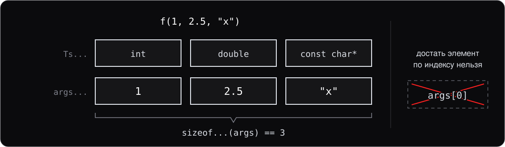
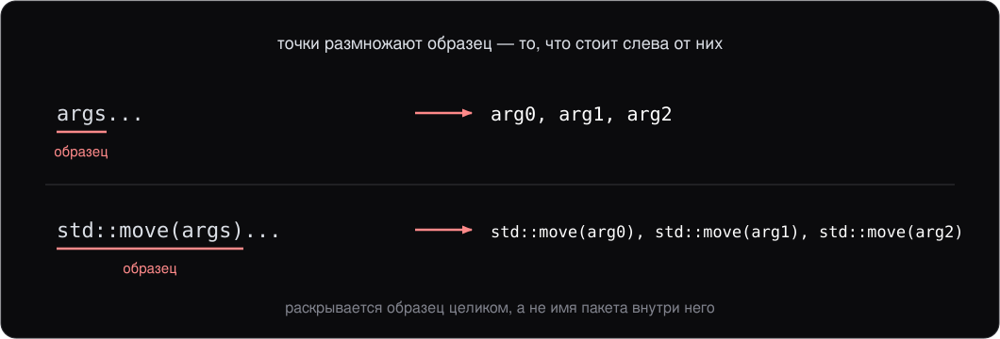
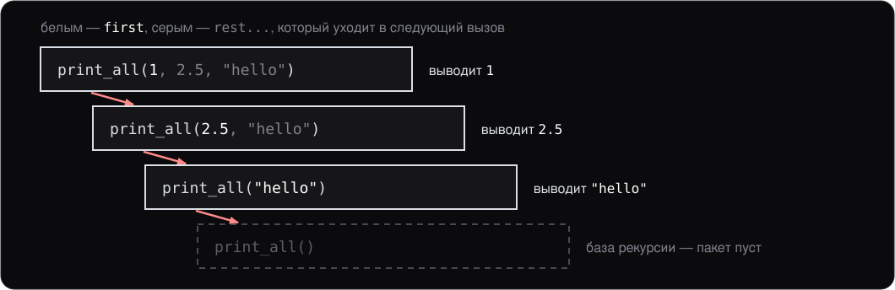
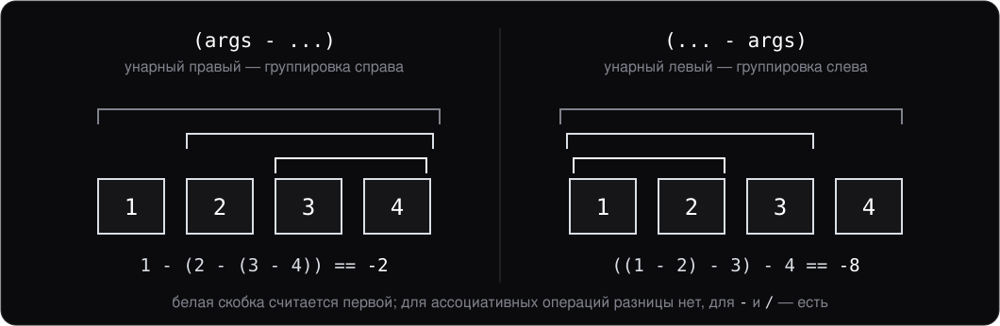

<style>
section {
    font-size: 25px;
}
</style>

<!-- _class: lead -->

# Лекция 9.

## Variadic templates и правила вывода типов

---

# План

1. Variadic templates
2. Раскрытие пакета
3. Классическая рекурсия по пакету
4. Fold expressions (C++17)
5. Применения variadic в реальности
6. Правила вывода типов

---
<!-- header: 1. Variadic templates -->

# 1. Variadic templates

Иногда функция должна принимать **любое число** аргументов разных типов:

```cpp
print("Hello, ", name, " you are ", age, " years old\n");
```

В C для этого был `va_list` — без типобезопасности. C++11 ввёл **variadic templates** — типобезопасный, compile-time, и без накладных расходов.

`std::tuple`, `std::variant`, `std::make_unique`, `std::format` — всё это построено на variadic templates.

---

## Синтаксис: пакет параметров

```cpp
template <typename... Ts>
void print_all(Ts... args);
```

- `typename... Ts` — **пакет параметров шаблона** (parameter pack): ноль или больше типов
- `Ts... args` — **пакет параметров функции**: соответствующие значения
- `args...` — **раскрытие пакета** (pack expansion)

---

## Пакет — это последовательность



Работать с пакетом можно только через раскрытие, рекурсию или fold expression.

---

## `sizeof...`

Узнать, сколько параметров в пакете:

```cpp
template <typename... Ts>
void f(Ts... args) {
    std::print("Got {} args\n", sizeof...(args));
}

f();             // 0
f(1, 2.0);       // 2
f(1, 2.0, "x");  // 3
```

`sizeof...(args)` — отдельный оператор (не путать с `sizeof(args)`).

---
<!-- header: 2. Раскрытие пакета -->

# 2. Раскрытие пакета

Пакет раскрывается **в разные контексты**:

```cpp
template <typename... Ts>
void forward_all(Ts... args) {
    other_func(args...);              // в список аргументов
}

template <typename... Ts>
auto make_array(Ts... args) {
    return std::array{args...};       // в initializer list
}

template <typename... Bases>
class Multi : public Bases... {       // в список баз класса
};
```

---

## Образец раскрытия



---
<!-- header: 3. Рекурсия -->

# 3. Классическая рекурсия по пакету

До C++17 единственный способ обработать каждый элемент пакета — **рекурсия**:

```cpp
void print_all() {}                    // база рекурсии

template <typename T, typename... Rest>
void print_all(T first, Rest... rest) {
    std::cout << first << ' ';
    print_all(rest...);                // рекурсивный вызов с остатком
}

print_all(1, 2.5, "hello");            // 1 2.5 hello
```

Работает, но требует двух функций.

---

## Что происходит при вызове



Три аргумента дают четыре инстанцирования (instantiation) — по одному на каждый суффикс пакета.

---

## `if constexpr` вместо базы рекурсии

```cpp
template <typename T, typename... Rest>
void print_all(T first, Rest... rest) {
    std::cout << first << ' ';
    if constexpr (sizeof...(rest) > 0) {
        print_all(rest...);            // для пустого остатка ветки нет
    }
}
```

Обычный `if` не годится: **обе** ветки обязаны компилироваться, а для последнего элемента пришлось бы инстанцировать `print_all()` без аргументов — CE.

`if constexpr` (C++17) считает условие на компиляции, и **невыбранная ветка не инстанцируется**. База рекурсии не нужна.

**Правило:** `if constexpr` нужен там, где ветки предъявляют разные требования к типу, то есть в шаблоне. Лямбда и функция с параметром `auto` — тоже шаблоны, хоть слова `template` в них нет.

---

## `if constexpr` вне шаблона

```cpp
constexpr bool kVerbose = false;

auto describe(int pid) {
    if constexpr (kVerbose) {
        return std::format("process {}", pid);   // std::string
    } else {
        return pid;                               // int
    }
}
```

С обычным `if` — CE: два `return` с разными типами. Отброшенный `return` в выводе типа (template argument deduction) не участвует.

Но отброшенная ветка **проверяется целиком**: `if constexpr (kLinux) { epoll_create1(0); }` на Windows — CE, имя не объявлено. Платформенный код остаётся за `#ifdef`.

---
<!-- header: 4. Fold expressions -->

# 4. Fold expressions (C++17)

C++17 даёт более выразительный способ — **fold expression**:

```cpp
template <typename... Ts>
auto sum(Ts... args) {
    return (args + ...);
}

sum(1, 2, 3, 4);    // 10
```

`(args + ...)` — **унарный правый fold** по `+`. Компилятор раскрывает его в:

```
arg1 + (arg2 + (arg3 + arg4))
```

---

## Четыре формы fold

| Форма | Раскрытие |
|---|---|
| `(args op ...)` | `arg1 op (arg2 op (... op argN))` — унарный правый |
| `(... op args)` | `((arg1 op arg2) op ...) op argN` — унарный левый |
| `(args op ... op init)` | плюс `init` справа — бинарный правый |
| `(init op ... op args)` | плюс `init` слева — бинарный левый |

**Бинарные формы** нужны для случая, когда пакет может быть **пустым** — `init` задаёт значение по умолчанию.

---

## Правый и левый fold



---

## Полезные примеры

```cpp
template <typename... Ts>
auto sum(Ts... args)         { return (args + ...); }

template <typename... Ts>
bool all_true(Ts... args)    { return (args && ...); }

template <typename... Ts>
bool any_true(Ts... args)    { return (args || ...); }
```

Fold по `,` (запятой) — стандартный способ «выполнить что-то для каждого элемента»:

```cpp
template <typename... Ts>
void print_all(Ts... args) {
    ((std::cout << args << ' '), ...);
}
```

---

## С `init` для пустых пакетов

```cpp
template <typename... Ts>
int sum0(Ts... args) {
    return (0 + ... + args);   // sum0() == 0, sum0(1,2,3) == 6
}
```

Без `init` унарный fold пустого пакета — это **CE** (для большинства операторов). Бинарная с `init = 0` работает корректно при любом размере пакета.

---

## Цикл по пакету: `template for` (C++26)

```cpp
template <typename... Ts>
void print_all(Ts... args) {
    template for (auto x : {args...}) {
        std::print("{} ", x);         // у x на каждом шаге свой тип
    }
}
```

Тело повторяется для каждого элемента пакета — как рекурсия, но без второй функции. В отличие от fold, в теле можно писать сколько угодно операторов.

Поддержка свежая: GCC 16 под `-std=c++26`, clang 22 ещё нет. Код курса — C++23, поэтому здесь `template for` только называется.

---
<!-- header: 5. Применения -->

# 5. Применения variadic в реальности

Стандартная библиотека:

```cpp
// std::make_unique принимает любые аргументы конструктора T
template <typename T, typename... Args>
unique_ptr<T> make_unique(Args&&... args);

// std::tuple хранит любое число значений разных типов
std::tuple<int, double, std::string> t{1, 2.5, "x"};

// std::format / std::print
std::print("{} {} {}\n", a, b, c);
```

Везде, где компилятор должен «принять любое число аргументов» — это variadic под капотом.

---

## Свой `make_unique`

```cpp
template <typename T, typename... Args>
std::unique_ptr<T> my_make_unique(Args... args) {
    return std::unique_ptr<T>(new T(args...));
}

auto p = my_make_unique<Point>(3, 4);   // Point(3, 4)
```

`args...` раскрывается в список аргументов для конструктора `T`. Один шаблон обслуживает любые типы и любое число аргументов.

Настоящий `std::make_unique` объявлен как `make_unique(Args&&... args)`. `&&` там — не rvalue-ссылка, а forwarding reference: вместе с `std::forward` она даёт идеальную передачу (perfect forwarding). Обе разбираются на лекции 11, раздел 8.

---
<!-- header: 6. Вывод типов -->

# 6. Правила вывода типов

Компилятор **выводит** `T` из аргумента (template argument deduction). Три шаблона `template <typename T> void f(...)` отличаются только параметром — он в заголовке столбца. Строка — вызов, ячейка — выведенный `T`:

| Аргумент | Вызов | `f(T x)` | `f(T& x)` | `f(const T& x)` |
|---|---|---|---|---|
| `int i = 5;` | `f(i)` | `int` | `int` | `int` |
| `const int ci = 10;` | `f(ci)` | `int` | `const int` | `int` |
| `const int& r = i;` | `f(r)` | `int` | `const int` | `int` |
| литерал | `f(5)` | `int` | CE | `int` |
| `const int* p = &i;` | `f(p)` | `const int*` | `const int*` | `const int*` |
| литерал | `f("abc")` | `const char*` | `const char[4]` | `char[4]` |

Например, `f(ci)` для `f(T& x)`: `T = const int`, и параметр `x` — `const int&`.

---

## Что читается из таблицы

Ссылку у аргумента компилятор снимает первым делом: `r` для него — `const int`. Поэтому строка `r` совпадает со строкой `ci`, а не `i`.

- **`f(T x)` — копия.** `const` самого аргумента копии не нужен и отбрасывается: в первых четырёх строках `T = int`.
- **`f(T& x)` — ссылка на оригинал.** `const` остаётся в `T`, иначе через `x` можно было бы изменить константу. `5` не проходит: временный объект (temporary object) к неконстантной ссылке не привязывается.
- **`f(const T& x)` принимает всё.** `const` уже записан в параметре, поэтому в `T` его нет.
- **Строка `p`:** константен не сам указатель, а `int`, на который он показывает. Этот `const` — часть типа и остаётся в любом столбце.
- **Строка `"abc"`:** массив `const char[4]` по значению не передать, и `f(T x)` получает указатель — **распад** (decay), как на лекции 2. Ссылка берёт массив целиком.

---

## Вывод возвращаемого типа (C++14)

```cpp
template <typename T, typename U>
auto add(T a, U b) {
    return a + b;  // тип — по обычным арифметическим преобразованиям
}

add(2, 3);        // int
add(2, 3.0);      // double
```

Так написаны `pair_sum` на лекции 8 и `sum` из раздела 4. Правила — те же, что в столбце `f(T x)`: ссылка и `const` самого значения отбрасываются.

Тело должно быть **видно в точке вызова** — значит, определение в заголовке. Несколько `return` с разными типами — CE; `return` в ветке, отброшенной `if constexpr`, не считается.

---

## `auto` в параметрах (C++20)

```cpp
auto add(auto a, auto b) { return a + b; }

// компилятор разворачивает в:
template <typename T, typename U>
auto add(T a, U b) { return a + b; }
```

**Сокращённая запись шаблона** (abbreviated function template): каждое `auto` — отдельный шаблонный параметр, выводится по той же таблице. Слова `template` нет, но это шаблон, и `if constexpr` в нём работает.

С концептами (concepts) — самый короткий ограниченный шаблон:

```cpp
auto sum(std::integral auto a, std::integral auto b) { return a + b; }
```

---

## Правило выживания

- Хотите, чтобы const сохранился? → `T& x` или `const T& x`
- Хотите менять? → `T& x`
- Хотите копию? → `T x` (но дорого для больших объектов)

---
<!-- header: Итоги -->

# Итоги лекции

- **Variadic templates** — `template <typename... Ts>`, пакеты, раскрытие `args...`
- **`sizeof...(args)`** — размер пакета (compile-time)
- **`if constexpr` (C++17)** — невыбранная ветка не инстанцируется; рекурсия без второй функции. Вне шаблона ветка проверяется целиком
- **Fold expressions (C++17)** — четыре формы, бинарные для пустых пакетов; в C++26 рядом встаёт `template for`
- **Fold по `,`** — стандартная идиома «сделай что-то для каждого»
- **Применения:** `make_unique`, `tuple`, `format`, ваши собственные factory-функции
- **Вывод типов:** для `T` отбрасываются `&` и `const` самого аргумента, массив распадается; для `T&` const сохраняется; `auto` в возврате и в параметрах — по тем же правилам

---

# Дальше

Следующая лекция — **лямбды + `std::function`**:

- Лямбды как шаблонные функторы (function objects), которые пишет компилятор
- Списки захвата
- Захват `this` и полей класса
- Захват с инициализацией (init-capture)
- `std::function` — универсальный контейнер для callable
