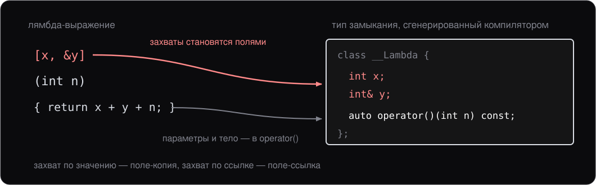

# Лекция 10. Лямбды и `std::function`

> Конспект к лекции для самостоятельного чтения. Слайды (`slides.md`) повторяют структуру, конспект подробнее объясняет «почему».

## 0. О чём эта лекция

Эта лекция стоит на стыке двух больших тем, которые мы уже прошли:

- **Классы с `operator()`** (лекция 5) — функторы, объекты, которые ведут себя как функции и могут хранить состояние.
- **Шаблоны** (лекции 8–9) — обобщённый код, работающий с разными типами без потери производительности.

Лямбды — это **синтаксический сахар** над **функтором**. Компилятор разворачивает короткую запись `[capture](args) { body }` в класс с `operator()`, имени которого программист не видит, а лямбда с параметром `auto` — в класс с шаблонным `operator()`. Понимая это, вы не воспринимаете лямбды как магию — вы видите, что под капотом ровно то, что мы уже изучили.

После основной части лекции — `std::function`. Это **универсальная обёртка** для любого callable: лямбды, функции, функтора, указателя на функцию. Через неё callable хранят в поле и передают в API, где его тип не известен заранее.

К концу лекции вы должны:

- Уметь писать лямбды с разными формами захвата.
- Понимать, что лямбда — это объект класса, который сгенерировал компилятор, и хранить её только под `auto`.
- Различать «когда лямбда напрямую» и «когда `std::function`», понимать цену второго.
- Уметь собрать type erasure руками: интерфейс с виртуальным вызовом, шаблонный наследник под тип цели, обёртка с указателем на базу.

## 1. Лямбды как функторы

Идея проста. Когда нужен короткий [callable](../glossary.md#callable) (по-русски — вызываемый объект) «на один раз» — писать целый [функтор](../glossary.md#functor) (function object, лекция 5), то есть класс с `operator()`, слишком много. Лямбда — это компактная запись для того же самого.

```cpp
auto add5 = [](int x) { return x + 5; };
std::cout << add5(10);    // 15
```

`add5` — это **[замыкание](../glossary.md#closure)** (closure): объект класса с `operator()(int)`, который компилятор сгенерировал из лямбда-выражения. Сам этот класс называется **типом замыкания** (closure type). Имя у него есть в бинарнике, но программисту оно недоступно. Поэтому лямбды живут под `auto`.

### Что компилятор разворачивает

```cpp
auto add5 = [](int x) { return x + 5; };
```

Это примерно эквивалентно:

```cpp
class __Lambda_42 {
public:
    auto operator()(int x) const { return x + 5; }
};

__Lambda_42 add5;
```

(Реальное имя класса зависит от компилятора, `__Lambda_42` здесь — условное.)

Ключевые наблюдения:

- **Каждая лямбда — отдельный тип.** Две лямбды с одинаковым телом, написанные в разных местах кода, имеют **разные типы**. Это нужно для [встраивания](../glossary.md#inlining) (inlining): каждая лямбда — это отдельный класс, который компилятор может оптимизировать независимо.
- **`operator()` по умолчанию `const`** — лямбда не меняет свои поля (если иное не указано через `mutable`).
- **Лямбда без захватов** — это пустой класс (sizeof = 1). С захватами — поля типа замыкания, по одному на каждый захват.

### Зачем нужны лямбды (а не функторы или функции)

```cpp
std::vector<int> v = {3, 1, 4, 1, 5};
std::sort(v.begin(), v.end(), [](int a, int b) { return a > b; });
```

vs. отдельный класс:

```cpp
struct DescendingCmp {
    bool operator()(int a, int b) const { return a > b; }
};
std::sort(v.begin(), v.end(), DescendingCmp{});
```

Одинаковый результат, но лямбда:

- **Локальна** — её код там же, где использование, не нужно заводить отдельный класс.
- **Захватывает** локальные переменные (об этом — следующий раздел). Функции этого не умеют.
- **Не загрязняет** именами — `DescendingCmp` теперь живёт в окружающей [области видимости](../glossary.md#scope) (scope), лямбда — нет.

vs. функция:

```cpp
bool descending(int a, int b) { return a > b; }
std::sort(v.begin(), v.end(), descending);
```

Функция работает, но **не может захватить состояние**. Если порог сравнения зависит от рантайм-параметра — функцией не обойтись.

## 2. Списки захвата

Лямбда может **захватить** локальные переменные из окружающей функции:

```cpp
int x = 10;
auto add_x = [x](int n) { return n + x; };
add_x(5);   // 15
```

`[x]` — это **список захвата**. Захваченные переменные становятся **полями** типа замыкания, а параметры и тело — его `operator()`:



Сколько захватов — столько полей, и от них зависит размер замыкания.

### По значению и по ссылке

```cpp
int x = 10;

auto by_val = [x](int n) { return n + x; };       // копия x
auto by_ref = [&x](int n) { return n + x; };      // ссылка на x

x = 100;
by_val(0);   // 10 (старая копия)
by_ref(0);   // 100 (свежее значение)
```


Разница целиком в том, что лежит полем внутри замыкания: снимок значения или ссылка на саму переменную.

### Захват по умолчанию

```cpp
int a = 1, b = 2;

auto f1 = [=](int n) { return n + a + b; };      // все локальные по значению
auto f2 = [&](int n) { a = b = n; return a; };   // все локальные по ссылке
auto f3 = [=, &b](int n) { b = n; return a; };   // a по значению, b по ссылке
```

`[=]` — захват **всех** упомянутых локальных переменных **по значению**.
`[&]` — захват **всех** упомянутых **по ссылке**.

Можно комбинировать: `[=, &b]` — все по значению, кроме `b` (по ссылке). Или `[&, a]` — все по ссылке, кроме `a` (копия).

В современном стиле часто **избегают `[=]` и `[&]`** — лучше явно перечислить, что захвачено. Это делает код понятнее и страхует от случайного захвата лишнего.

### Подвох: висячая ссылка

```cpp
auto make_lambda() {
    int x = 10;
    return [&x] { return x; };     // x умрёт после возврата!
}

auto f = make_lambda();
f();    // UB: используем ссылку на мёртвый объект
```


Захват по ссылке требует, чтобы захваченные переменные **жили** дольше лямбды. Если лямбда переживёт текущую функцию (вернётся наружу, попадёт в `std::function`, в контейнер) — ссылка на захваченную локальную переменную станет **[висячей](../glossary.md#dangling)** (dangling reference).

**Правило:** если лямбда **переживёт** текущую функцию — захватывайте по значению. Если живёт строго внутри одной области видимости — можно по ссылке (часто и удобнее).

### `mutable`

По умолчанию `operator()` лямбды — `const`. Это значит, что захваченные **по значению** переменные **нельзя менять** внутри лямбды:

```cpp
int x = 10;
auto f = [x] { x = 20; };       // CE: x — поле const-метода
auto g = [x]() mutable { x = 20; };   // ok, mutable снимает const
```

`mutable` снимает const с `operator()`. Меняется при этом **захваченная копия**, не оригинал — это просто разрешение изменять собственные поля лямбды.

## 3. Лямбды как объекты

Поскольку лямбда — это объект, её можно:

```cpp
auto f = [](int x) { return x * 2; };

f(5);                  // вызов
auto g = f;            // копия (если захваты копируются)
sizeof(f);             // размер — определяется захватами
auto h = std::move(f); // move (если захваты перемещаемые)
```

### Размер

Лямбда без захватов имеет размер 1 байт (минимальный размер любого класса в C++ — пустой класс не может иметь sizeof = 0). С захватами — размер зависит от типов и числа захваченных переменных, как у обычной структуры:

```cpp
auto f = [a = 1, b = 2.0, c = std::string("x")] { return a; };
// sizeof(f) ≈ sizeof(int) + sizeof(double) + sizeof(std::string) + padding
```

### `auto` обязателен

Тип замыкания у компилятора есть, но имени, которое можно написать руками, у него нет:

```cpp
auto f = [](int x) { return x * 2; };       // ok, auto
SomeType f = [](int x) { return x * 2; };   // невозможно — нет имени типа
```

Поэтому лямбды всегда живут под `auto`. Если нужно сохранить лямбду как параметр функции — есть два пути:

- **Шаблон** — `template <typename F> void g(F f)`. Тип лямбды выводится при вызове.
- **`std::function`** — обёртка, в которую помещается callable любого типа. Об этом — в разделе 7.

### `decltype` — имя для типа замыкания

Иногда всё-таки нужно **сослаться на тип** лямбды — например, чтобы использовать его как шаблонный аргумент. Для этого есть `decltype(expr)`, который возвращает тип переданного выражения:

```cpp
auto cmp = [](int a, int b) { return a > b; };

std::set<int, decltype(cmp)> s(cmp);
std::priority_queue<int, std::vector<int>, decltype(cmp)> q(cmp);
```

`decltype(cmp)` — это тот самый тип замыкания, который сгенерировал компилятор. Имя этого класса написать руками нельзя, но `decltype` даёт способ **на него сослаться**.

Это типичный приём, когда нужно передать лямбду как **шаблонный параметр** контейнера (компараторы для `std::set`, `std::priority_queue`, `std::map`).

Полный разбор `decltype` (вместе с `auto` и `decltype(auto)`) — на лекции 12. Сейчас знайте, что эта конструкция есть, и помните её как способ «получить тип лямбды».

### Преобразование в указатель на функцию

Только лямбды **без захватов** допускают [неявное преобразование](../glossary.md#implicit-conversion) (implicit conversion) в обычный указатель на функцию:

```cpp
auto plain = [](int x) { return x * 2; };
int (*fp)(int) = plain;        // ok, преобразование в указатель на функцию

auto capturing = [n = 5](int x) { return x + n; };
int (*fp2)(int) = capturing;   // CE: нельзя
```

Логика: указатель на функцию — это «просто адрес». В нём нет места для захваченных полей. Поэтому только пустые лямбды могут быть представлены как голый указатель.

Это полезно для **работы с C-API**, которые ожидают [колбэк](../glossary.md#callback) (callback) вида `void (*callback)(int)` или подобного. Лямбда без захватов передаётся туда напрямую. С захватами — так не выйдет, и нужен отдельный приём с контекстом: он разобран в разделе 8.

### Откуда берётся преобразование

В разделе 1 тип замыкания был показан с одним методом, `operator()`. У лямбды без захватов компилятор дописывает второй — **[оператор преобразования](../glossary.md#conversion-operator)** (conversion operator). Это метод с именем `operator T()`, который превращает объект в тип `T`; возвращаемый тип в объявлении не пишется, он уже в имени. Для `plain` получается примерно такой класс:

```cpp
class __Lambda_43 {
public:
    using Fn = int (*)(int);

    int operator()(int x) const { return invoke(x); }
    operator Fn() const { return &invoke; }   // замыкание → указатель
private:
    static int invoke(int x) { return x * 2; }   // тело лямбды
};
```

Строка `int (*fp)(int) = plain;` вызывает `operator Fn()` и получает адрес `invoke`. Тело лямбды лежит в статической функции, а у статической функции нет `this`: полей объекта она не видит. Для лямбды без захватов это неважно, полей у неё нет. Лямбде с захватами телу нужны поля, и статическую функцию для неё не построить — вот почему преобразования у неё нет. Раздел 8 решает ту же задачу руками: там статическая функция получает объект отдельным параметром.

### Оператор преобразования в своём классе

Такой оператор можно написать в любом классе. Чаще всего пишут `operator bool` — «объект в рабочем состоянии»:

```cpp
class Handle {
public:
    explicit Handle(int fd) : fd_(fd) {}
    explicit operator bool() const { return fd_ >= 0; }
private:
    int fd_{-1};
};

Handle log{3}, sock{7};
if (log) { /* ... */ }               // ok
if (!log || !sock) return;           // ok
bool ok = log;                       // CE: нужен static_cast<bool>(log)
int n = log + sock;                  // CE
```

`explicit` здесь по той же причине, что у конструктора с одним аргументом на лекции 4: неявное преобразование срабатывает там, где его никто не просил. Без `explicit` последняя строка компилируется и даёт 2: оба объекта превращаются в `true`, а `true + true` по правилам арифметики — это 2. Так же молча скомпилируется `log == sock`, и сравнятся два `bool`, а не два дескриптора.

С `explicit` оператор вызывается [кастом](../glossary.md#cast) (cast) — и ещё там, где язык ждёт условие: в `if`, `while`, `for`, в операндах `!`, `&&`, `||` и в первом операнде `?:`. Это **[контекстное преобразование](../glossary.md#contextual-conversion)** (contextual conversion). Поэтому `explicit operator bool` ничего не отнимает у `if (log)`, а лишнее запрещает. Так устроены `std::function` из раздела 7 (`if (op)` — «цель задана»), `std::unique_ptr`, `std::optional` и потоки ввода: `while (std::getline(in, line))` проверяет поток именно им.

**Правило:** оператор преобразования помечайте `explicit`, как и конструктор с одним аргументом.

## 4. Захват полей класса и `this`

Внутри метода класса захват полей работает **через `this`**:

```cpp
class Counter {
    int count_ = 0;
public:
    auto make_incrementer() {
        return [this] { ++count_; };   // захватили this
    }
};
```

`[this]` — захват **указателя на объект**. Лямбда видит все поля и методы через `this`, ровно как обычный метод этого класса.

Можно явно написать `[this, &count_]` — но это не нужно, имена полей и так доступны через `this`.

### Подвох: время жизни объекта

`[this]` — это **указатель**. Если объект умрёт раньше лямбды — [UB](../glossary.md#ub) (undefined behavior):

```cpp
auto make_lambda() {
    Counter c;
    return c.make_incrementer();   // лямбда захватила &c
}                                   // c умирает здесь

auto f = make_lambda();
f();   // UB: используем умерший объект
```

Это та же проблема, что с захватом локальной переменной по ссылке, только применённая к объекту класса.

С C++17 есть **`[*this]`** — захват **копии всего объекта**:

```cpp
class Counter {
public:
    auto make_incrementer() {
        return [*this] { /* копия объекта внутри лямбды */ };
    }
};
```


Оригинал может умереть — копия жива, пока живёт лямбда. Полезно ровно для случаев, когда лямбда переживёт объект.

## 5. Захват с инициализацией (C++14)

C++14 позволил создать **новое имя** в захвате через произвольное выражение — это **[захват с инициализацией](../glossary.md#init-capture)** (init-capture):

```cpp
int x = 10;
auto f = [y = x * 2](int n) { return n + y; };   // y = 20
f(5);   // 25
```

Это полезно для нескольких сценариев.

### Move-захват

[Move-семантику](../glossary.md#move-semantics) (move semantics) мы будем разбирать в следующей лекции, но достаточно знать, что `std::unique_ptr` **нельзя копировать, только move**. Захват с инициализацией позволяет именно move:

```cpp
auto ptr = std::make_unique<int>(42);
auto f = [p = std::move(ptr)] { return *p; };
// после этой строки ptr пуст; p — владелец, внутри лямбды
```

Без захвата с инициализацией так не сделать — `[ptr]` пытается скопировать `ptr`, а `unique_ptr` копировать нельзя.

### Произвольные выражения

```cpp
std::vector<int> v = {1, 2, 3};
auto f = [size = v.size()](int n) { return n * size; };
```

Можно положить в захват результат вычисления, который потом не нужно повторно делать в каждом вызове лямбды.

## 6. Шаблонные лямбды

### `auto` параметр (C++14)

С C++14 в лямбдах можно использовать `auto` в качестве типа параметра:

```cpp
auto print = [](auto x) { std::cout << x << ' '; };
print(42);        // int
print(3.14);      // double
print("hello");   // const char*
```

`auto` здесь — синоним `typename T` для шаблонной функции. Компилятор генерирует **шаблонный `operator()`** в типе замыкания:

```cpp
class __PrintLambda {
public:
    template <typename T>
    auto operator()(T x) const { std::cout << x << ' '; }
};
```

То есть `print` — это **один объект**, но его `operator()` — шаблонный. Каждый вызов с новым типом приводит к [инстанцированию](../glossary.md#instantiation) (instantiation) новой версии метода.

### Явный шаблонный синтаксис (C++20)

С C++20 можно писать шаблон в лямбде явно:

```cpp
auto first = []<typename T>(const std::vector<T>& v) {
    return v.front();
};

first(std::vector{1, 2, 3});   // T = int
```

Зачем это нужно — когда вам нужно **достать** тип `T` (например, из контейнера) или ограничить его [концептом](../glossary.md#concept) (concept). С `auto`-параметром этого было сделать неудобно.

## 7. `std::function` — универсальный callable

У каждой лямбды свой тип. Это удобно для шаблонного кода — компилятор знает точный тип и может встроить вызов. Но иногда нужно **хранить** разные callable в одной переменной или принимать «любой callable» в **нешаблонной** функции:

```cpp
std::vector<???> callbacks;     // что положить — все лямбды разных типов?
```

Решение — **`std::function<Signature>`**: обёртка, в которую помещается любой callable с подходящей [сигнатурой](../glossary.md#signature) (signature).

### Использование

```cpp
#include <functional>

std::function<int(int, int)> op;     // любой callable (int, int) → int

op = [](int a, int b) { return a + b; };
std::cout << op(3, 5) << '\n';        // 8

int sub(int a, int b) { return a - b; }
op = sub;                              // обычная функция
std::cout << op(10, 3) << '\n';       // 7

struct Multiplier {
    int factor;
    int operator()(int a, int b) const { return a * b * factor; }
};
op = Multiplier{2};                    // функтор с состоянием
std::cout << op(4, 6) << '\n';        // 48
```

Один тип `std::function<int(int, int)>` принимает всё: лямбду, функцию, функтор. Все они дают одинаковое поведение при вызове через `op()`.

### Type erasure руками

Как один тип принимает лямбду, функцию и функтор, если общего у них только то, что их можно вызвать? Приём называется **[type erasure](../glossary.md#type-erasure)** (по-русски — стирание типа): объекты разных типов хранятся за одним интерфейсом без общего базового класса. Собирается он из двух уже пройденных механизмов — виртуального вызова (лекция 7) и шаблона класса (лекция 8). Соберём его для одной сигнатуры, `int(int, int)`.

**Шаг 1. Интерфейс.** Хранить объекты разных типов в одной переменной умеет полиморфизм: указатель на базу и [виртуальная функция](../glossary.md#virtual-function) (virtual function). Базе нужна ровно одна — «вызови меня»:

```cpp
class ICallable {
public:
    virtual ~ICallable() = default;
    virtual int call(int a, int b) = 0;
};
```

**Шаг 2. Наследник под каждый тип.** Лямбда от `ICallable` не унаследована и унаследоваться не может: её класс пишет компилятор. Значит наследника для неё заводим мы — шаблоном, который хранит цель полем и в `call` вызывает её:

```cpp
template <typename F>
class CallableHolder : public ICallable {
public:
    explicit CallableHolder(F f) : f_(f) {}
    int call(int a, int b) override { return f_(a, b); }

private:
    F f_{};
};
```

`CallableHolder<F>` — не один класс, а по классу на каждый тип цели: для лямбды компилятор инстанцирует свой, для `Multiplier` — свой. От цели требуется одно — чтобы выражение `f_(a, b)` компилировалось. Наследовать что-либо ей не нужно.

**Шаг 3. Обёртка.** Снаружи остаётся класс без шаблонного параметра; шаблонный у него только конструктор:

```cpp
class BinaryOp {
public:
    template <typename F>
    BinaryOp(F f) : impl_(std::make_unique<CallableHolder<F>>(f)) {}

    int operator()(int a, int b) const { return impl_->call(a, b); }

private:
    std::unique_ptr<ICallable> impl_{};
};
```

Тип цели известен ровно в одной точке — в конструкторе. Там из него получается наследник `CallableHolder<F>`, наследник уходит в [кучу](../glossary.md#heap) (heap), а в обёртке остаётся указатель на базу. Дальше `BinaryOp` тип цели не помнит: тип **стёрт**, и от него осталась только [vtable](../glossary.md#vtable) наследника.


```cpp
int sub(int a, int b) { return a - b; }

std::vector<BinaryOp> ops;
ops.push_back([](int a, int b) { return a + b; });   // лямбда
ops.push_back(sub);                                    // функция
ops.push_back(Multiplier{2});                          // функтор

for (const BinaryOp& op : ops) {
    std::println("{}", op(4, 6));                      // 10, -2, 48
}
```

Три следствия, которые видны прямо в коде:

- **`sizeof(BinaryOp)` не зависит от цели.** Это один указатель, сколько бы байт ни захватила лямбда. Ради этого приём и нужен: объекты одного типа и одного размера ложатся в один `std::vector`.
- **`operator()` константный, а `call` — нет.** `const` у обёртки делает константным указатель `impl_`, но не объект, на который он смотрит. Поэтому через константную обёртку вызывается и цель, которая меняет своё состояние, — например, лямбда с `mutable` (раздел 2).
- **`BinaryOp` не копируется:** внутри `unique_ptr`, и копировать его отказывается компилятор. `std::function` копируется — к операции «вызови» у него добавлена вторая, «скопируй цель»; в нашей схеме это был бы ещё один виртуальный метод базы. Отсюда требование, которое разобрано [ниже](#подвох-цель-обязана-копироваться): цель обязана копироваться.

### Что внутри

`std::function` устроен по той же схеме, с двумя отличиями. Сигнатура у него — параметр шаблона: `function<R(Args...)>` разбирает её [частичной специализацией](../glossary.md#specialization) (partial specialization; лекция 9, раздел 5), и `int` с `(int, int)` из `BinaryOp` становятся `R` и `Args...`. А маленькая цель кладётся не в кучу, а в буфер внутри самой обёртки:


Отсек «как вызывать» на схеме играет роль vptr из `BinaryOp`. В стандартных библиотеках там обычно не виртуальная функция, а указатель на функцию — та же таблица вызовов руками, что на лекции 7.

Это даёт **универсальность** ценой нескольких накладных расходов:

- **Выделение памяти в [куче](../glossary.md#heap)** (heap) для callable, который не помещается во встроенный буфер обёртки. Сам буфер — **[SBO](../glossary.md#sbo)** (small buffer optimization), обычно до ~16 байт: маленькие лямбды без захватов влезают, большие с захватами — нет.
- **[Косвенный вызов](../glossary.md#indirect-call)** (indirect call) при `operator()`: компилятор не может встроить тело callable.
- Большая обёртка — `sizeof(std::function)` обычно 32-64 байта.

### Подвох: цель обязана копироваться

Наследник хранит копию цели полем — у `BinaryOp` это `f_`. Для `std::function` это не деталь реализации, а требование стандарта. `std::function` копируется сам, а копия обёртки означает копию того, что внутри; значит цель обязана быть copy-constructible. Проверяется это при присваивании:

```cpp
#include <fstream>
#include <functional>
#include <string>

struct FileWriter {
    std::ofstream out;
    explicit FileWriter(const std::string& path) : out(path) {}
    void operator()(int value) { out << value << '\n'; }
};

std::function<void(int)> sink = FileWriter{"log.txt"};   // не компилируется
```

```
error: static assertion failed due to requirement 'is_copy_constructible_v<FileWriter>':
       The target function object type must be copy constructible
```

`std::ofstream` копировать нельзя — у потока один дескриптор, и [владение](../glossary.md#ownership) (ownership) им не делится: второго владельца ему не положено. Функтор с потоком внутри копироваться перестал, и `std::function` его не берёт. С захватом `std::unique_ptr` (раздел 5) отказ будет тот же.

### `std::move_only_function` (C++23)

Для этого случая в C++23 есть вторая обёртка — `std::move_only_function`. Она не копируется сама и потому не требует копируемости от цели:

```cpp
std::move_only_function<void(int)> sink = FileWriter{"log.txt"};   // работает
sink(42);
```

Платит она другим. У `std::function` `operator()` константный, у `std::move_only_function` — нет: цель вправе менять своё состояние (тот самый поток), и обёртка не обещает константность, которой у неё нет. Отсюда следствие, из-за которого замена одного типа на другой редко бывает механической, — вызвать её через `const&` нельзя:

```cpp
void Publish(const std::move_only_function<void(int)>& sink) {
    sink(42);        // error: no matching function for call to object of type
}                    //        'const std::move_only_function<void (int)>'
```

Константность заявляется в самой сигнатуре, если она верна для всех целей: `std::move_only_function<void(int) const>`. Но такая обёртка не примет цель с неконстантным `operator()` — то есть ровно тот функтор с потоком, ради которого всё и затевалось. Выбирать приходится одно из двух.

**Правило:** `std::function` — пока все цели копируются; `std::move_only_function` — когда среди них есть владеющая ресурсом. Односторонняя совместимость: `std::function` внутрь `std::move_only_function` кладётся, обратно — нет.

### Когда использовать

| Ситуация | Что использовать |
|---|---|
| Тип callable известен, нужен один тип | Шаблонный параметр `template <typename F>` |
| Лямбда передаётся в алгоритм [STL](../glossary.md#stl) (стандартной библиотеки шаблонов) | Шаблонный параметр (STL так и устроено) |
| Нужно **хранить** разные callable в одной переменной | `std::function` |
| API класса должно принимать «любой callable» (нешаблонный метод) | `std::function` |
| Подписки, события, колбэки с гетерогенными подписчиками | `std::function` |
| Цель владеет ресурсом (поток, `unique_ptr`) и не копируется | `std::move_only_function` |

**Правило:** не используйте `std::function` без необходимости. Если шаблонный параметр работает — он быстрее. `std::function` — для случаев, когда **тип нужно стереть**.

### Пример: подписки

```cpp
class EventBus {
public:
    using Handler = std::function<void(const Event&)>;

    void subscribe(Handler h) {
        handlers_.push_back(std::move(h));
    }

    void publish(const Event& e) {
        for (auto& h : handlers_) h(e);
    }

private:
    std::vector<Handler> handlers_;
};

bus.subscribe([](const Event& e) { /* ... */ });
bus.subscribe(my_function);
bus.subscribe(my_functor);
```

`std::function` — **стандартный способ** хранить произвольные колбэки в API классов. Шаблон здесь не подойдёт: разные подписки нужно держать в одном `std::vector`.

## 8. Лямбда и C-API: контекст через `void*`

`std::function` из предыдущего раздела — решение для C++-кода: и подписчик, и шина событий написаны на C++, и оба знают про шаблоны, про типы, про исключения. Но подписаться часто нужно не на свою шину, а на **чужую C-библиотеку**: так устроены системные и сторонние библиотеки, отдающие поток событий. Там ни `std::function`, ни лямбды не существует, и интерфейс выглядит по-другому.

### Как выглядит C-колбэк

Типичное объявление в заголовке C-библиотеки:

```cpp
struct lib_event {
    int pid;
    const char* name;
};

void lib_subscribe(void (*cb)(const lib_event*, void*), void* ctx);
```

Два параметра: указатель на функцию и `void* ctx`. Второй параметр кажется лишним — но без него библиотека была бы бесполезна.

Причина в том, что **у указателя на функцию нет состояния**. Это просто адрес кода: восемь байт, в которых негде хранить «а кому именно доставлять события». Один и тот же адрес одинаково работает для всех подписчиков. В C++ состояние носят с собой объекты (функторы, лямбды с захватами), в C такого механизма нет — поэтому состояние передают **вторым, отдельным параметром**, а библиотека обязуется вернуть его без изменений в каждый вызов колбэка.

`void*` здесь означает «библиотека не знает и не хочет знать, что это за объект; она только передаст указатель обратно». Разбираться с типом — задача вызывающей стороны.

**Правило:** в C-API код и состояние всегда едут отдельно: функция — в указателе на функцию, состояние — в `void*`.

### Лямбда с захватами туда не проходит

Первое желание — передать лямбду, захватившую `this`:

```cpp
class Collector {
    int seen_ = 0;
public:
    void subscribe() {
        lib_subscribe([this](const lib_event*, void*) { ++seen_; }, this);
    }
};
```

Это не компилируется:

```
error: cannot convert 'Collector::subscribe()::<lambda(const lib_event*, void*)>'
       to 'void (*)(const lib_event*, void*)'
```

Причина ровно та, что разобрана в разделе 3: захват `[this]` — это **поле** типа замыкания, который сгенерировал компилятор. Значит перед нами объект с состоянием, а не функция. Указателем на функцию его не представить: адреса кода недостаточно, потерялось бы поле.

### Решение: статическая функция-трамплин

**[Трамплин](../glossary.md#trampoline)** (trampoline) — свободная или статическая функция ровно той сигнатуры, которую ждёт библиотека. Её единственная работа: привести `ctx` обратно к типу нашего объекта и позвать у него нормальный C++-метод.

```cpp
static void trampoline(const lib_event* e, void* ctx) noexcept {
    static_cast<Collector*>(ctx)->on_event(*e);
}
```

Статический метод (как и свободная функция) не имеет неявного `this`, поэтому его тип — обычный `void (*)(const lib_event*, void*)`, и преобразование проходит. Состояние при этом не потеряно — оно приехало в `ctx`.


В C-API код и состояние едут раздельно, и свести их обратно может только наша сторона: тип объекта известен ей одной.

Обратное приведение делаем `static_cast` (лекция 3): преобразование `void*` в `T*` — как раз его штатная задача, `reinterpret_cast` здесь не нужен. Важно только, чтобы тип совпадал с тем, чей адрес мы клали в `ctx`: `static_cast` не проверяет ничего, и ошибка в типе даёт UB.

### Полный пример

Настоящую библиотеку здесь имитирует пара функций: `lib_subscribe` запоминает колбэк, `lib_emit` его вызывает. Пример компилируется и запускается целиком.

```cpp
#include <print>
#include <string>
#include <vector>

// --- заголовок C-библиотеки (в реальности — внутри extern "C") ---
struct lib_event {
    int pid;
    const char* name;
};

void lib_subscribe(void (*cb)(const lib_event*, void*), void* ctx);

// --- имитация библиотеки ---
namespace {
void (*g_cb)(const lib_event*, void*) = nullptr;
void* g_ctx = nullptr;
}  // namespace

void lib_subscribe(void (*cb)(const lib_event*, void*), void* ctx) {
    g_cb = cb;
    g_ctx = ctx;
}

void lib_emit(int pid, const char* name) {
    lib_event e{pid, name};
    if (g_cb != nullptr) {
        g_cb(&e, g_ctx);
    }
}

// --- наша C++-сторона ---
class EventCollector {
public:
    void subscribe() { lib_subscribe(&trampoline, this); }

    std::size_t count() const { return names_.size(); }

private:
    void on_event(const lib_event& e) {
        names_.push_back(e.name);
        std::print("событие: pid={}, name={}\n", e.pid, e.name);
    }

    static void trampoline(const lib_event* e, void* ctx) noexcept {
        auto* self = static_cast<EventCollector*>(ctx);
        try {
            self->on_event(*e);
        } catch (...) {
            // наружу, через границу C, бросать нельзя
        }
    }

    std::vector<std::string> names_;
};

int main() {
    EventCollector collector;
    collector.subscribe();

    lib_emit(1042, "svc_host");
    lib_emit(1043, "backup_tool");

    std::print("собрано: {}\n", collector.count());
}
```

Вывод:

```
событие: pid=1042, name=svc_host
событие: pid=1043, name=backup_tool
собрано: 2
```

Что здесь важно:

- `trampoline` — **приватный** статический метод. Он часть реализации класса, наружу его показывать незачем, а доступ к приватному `on_event` у него есть.
- В `ctx` уходит `this`. Всё, что нужно обработчику — поля объекта, — доступно ему как обычно.
- Внутри `on_event` мы снова в полноценном C++: контейнеры, строки, исключения. Граница с C проходит строго по трамплину.

### Подводные камни

**[Время жизни](../glossary.md#lifetime) (lifetime) объекта.** В `ctx` уезжает голый адрес. Библиотека за ним не следит: она не знает ни типа, ни времени жизни, и будет дёргать колбэк, пока подписка активна. Значит объект обязан **пережить подписку**:

```cpp
void bad() {
    EventCollector collector;
    collector.subscribe();
}   // collector умер, а подписка осталась — следующий колбэк это UB
```

Адрес [временного объекта](../glossary.md#temporary) (temporary object) передавать тем более нельзя. **Правило:** отписка должна происходить до разрушения объекта — обычно её ставят в деструктор того же класса ([RAII](../glossary.md#raii), resource acquisition is initialization; лекция 2).

**Перемещение и переезд по памяти.** Объект, зарегистрированный в C-API, нельзя перемещать или копировать с расчётом, что подписка «переедет» вместе с ним: `ctx` продолжит указывать на старое место. По той же причине опасно подписывать элемент `std::vector` — при росте вектор перевыделяет буфер, и все элементы меняют адреса, а библиотека об этом не узнает. Держите такие объекты по стабильному адресу (например, в `std::unique_ptr`) или запрещайте им move явно. Подробно про перемещение — лекция 11, про `unique_ptr` — лекции 2 и 15.

**Исключения не пересекают границу C.** Если исключение вылетит из колбэка наружу, [раскрутка стека](../glossary.md#stack-unwinding) (stack unwinding) пойдёт сквозь кадры C-библиотеки, которые к этому не готовы, — это UB. Поэтому колбэк не должен бросать:

```cpp
static void trampoline(const lib_event* e, void* ctx) noexcept {
    try {
        static_cast<EventCollector*>(ctx)->on_event(*e);
    } catch (...) {
        // залогировать, запомнить в объекте, вернуть управление библиотеке
    }
}
```

`noexcept` фиксирует контракт (лекция 3): если что-то всё же прорвётся, программа честно завершится через `std::terminate`, а не уйдёт в UB. Сама ошибка при этом никуда не пропадает — её сохраняют в полях объекта и разбирают уже на C++-стороне, там, где есть кому её обработать. Про выбор механизма для такого разбора — лекция 14.

### Когда трамплин не нужен

Если захватывать нечего, отдельная функция не нужна: лямбда **без захватов** преобразуется в указатель на функцию напрямую (раздел 3), поэтому трамплином может быть она сама, прямо в месте регистрации:

```cpp
void EventCollector::subscribe() {
    lib_subscribe(
        [](const lib_event* e, void* ctx) noexcept {
            static_cast<EventCollector*>(ctx)->on_event(*e);
        },
        this);
}
```

Захваты здесь и не нужны — весь контекст уже приехал параметром `ctx`. Это тот же трамплин, просто записанный компактнее; выбор между ним и статическим методом — вопрос вкуса и размера тела.

А вот если в C-API **нет** параметра для контекста (колбэк принимает только событие) — передать состояние нечем в принципе. Остаются глобальные переменные; это плохой интерфейс, и обходных путей у вызывающей стороны нет.

## Итоги

- **Лямбда — это функтор, который сгенерировал компилятор.** Её объект — замыкание, его класс с `operator()` — тип замыкания. Эта связь между классами с `operator()` (лекция 5) и шаблонами (лекции 8–9) — суть лямбд.
- **Каждая лямбда — отдельный тип.** Хранится только под `auto`. Хотите хранить разные лямбды в одной переменной — нужен `std::function`. Хотите сослаться на тип замыкания (для шаблонного параметра) — `decltype(my_lambda)`.
- **Лямбда без захватов преобразуется в указатель на функцию** оператором преобразования, который дописал компилятор. В своём классе такой оператор помечают `explicit`; `explicit operator bool` всё равно работает в `if`, `!` и `&&` — это контекстное преобразование.
- **Списки захвата:** по значению `[x]`, по ссылке `[&x]`, по умолчанию `[=]` / `[&]`. Захват по ссылке требует, чтобы захваченное жило дольше лямбды.
- **`mutable`** снимает `const` с `operator()` и разрешает менять захваченные по значению поля.
- **Захват с инициализацией `[y = expr]`** — для move и для произвольных выражений.
- **`[this]`** — захват указателя на объект. `[*this]` (C++17) — захват копии всего объекта.
- **Шаблонные лямбды:** `auto`-параметр (C++14) или явный `<typename T>` (C++20).
- **Type erasure** собирается из трёх частей: база с виртуальным `call`, шаблонный наследник, который хранит цель, и обёртка с указателем на базу. Тип цели известен только в шаблонном конструкторе; размер обёртки от цели не зависит.
- **`std::function`** — обёртка с type erasure для любого callable. Стандартный способ хранить колбэки и иметь нешаблонные API. Цена: одно выделение памяти в куче + косвенный вызов.
- **C-API с колбэком:** у указателя на функцию нет состояния, поэтому контекст передают отдельным `void*`. Лямбда с захватами в такой параметр не преобразуется — нужен **статический трамплин**, который приводит `ctx` к типу объекта и зовёт метод. Лямбде без захватов трамплин не нужен, она преобразуется сама.
- **Границы C:** объект из `ctx` обязан пережить подписку и не переезжать по памяти, а колбэк — не бросать исключений (`noexcept` + `catch (...)` внутри трамплина).

## Что дальше

Следующая лекция — **move-семантика и [идеальная передача](../glossary.md#perfect-forwarding)** (perfect forwarding):

- Зачем нужна move-семантика (где копирование лишнее)
- `std::move`, [категории значения](../glossary.md#value-category) (value categories): [lvalue / rvalue](../glossary.md#lvalue)
- [Move-конструктор](../glossary.md#move-constructor) (move constructor) и move-`operator=`
- [Правило пяти](../glossary.md#rule-of-three) (rule of five) и [специальные функции-члены](../glossary.md#special-member-functions) (special member functions)
- Исправление вектора под move
