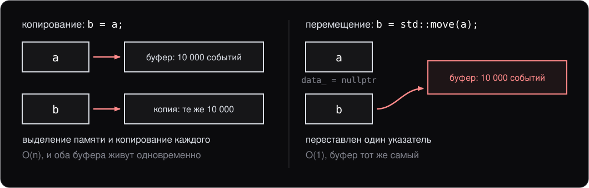
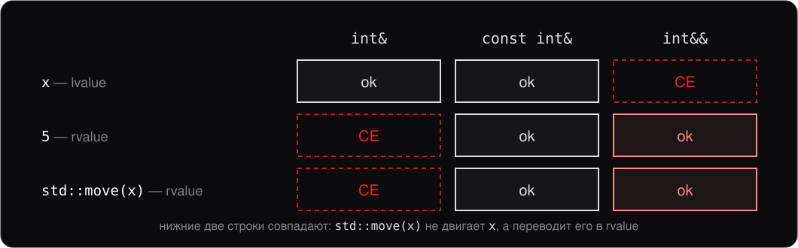
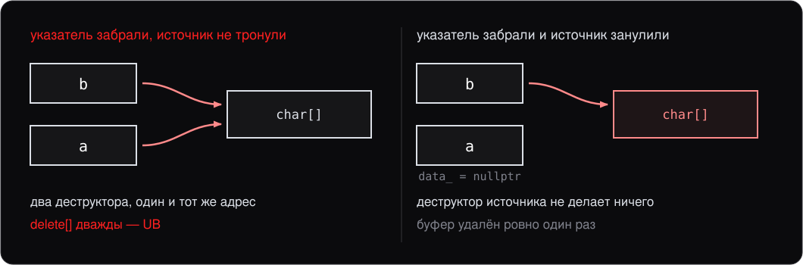
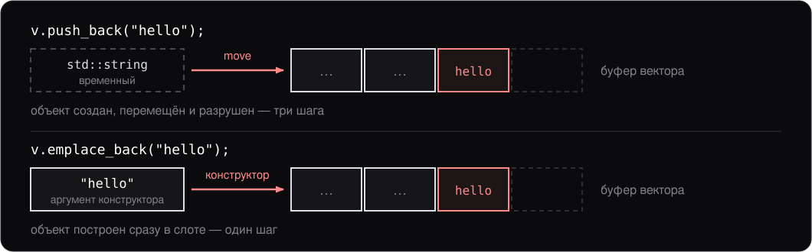
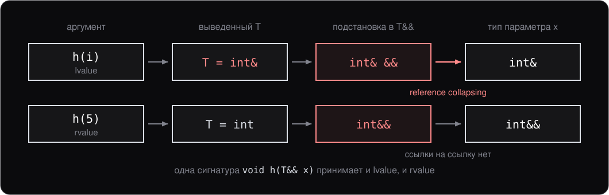

# Лекция 11. Move-семантика и идеальная передача

> Конспект к лекции для самостоятельного чтения. Слайды (`slides.md`) повторяют структуру, конспект подробнее объясняет «почему».

## 0. О чём эта лекция

Move-семантика — одна из главных фич C++11 и одна из тех вещей, которые отличают «современный» C++ от старого. Без неё было невозможно эффективно возвращать большие объекты из функций, хранить move-only типы вроде `std::unique_ptr` в контейнерах, делать `O(1)`-swap. С её появлением весь язык сильно перестроился — стандартная библиотека, идиоматический стиль, правила неявного объявления специальных функций-членов.

Сегодня:

- Зачем move-семантика существует — на примере с `swap` и возвратом больших объектов.
- Категории значения (lvalue / rvalue) на уровне «достаточно для понимания move» и новый вид ссылки — rvalue-ссылка `T&&`.
- Что делает `std::move` и почему это просто каст.
- Как написать свой move-конструктор и move-`operator=`.
- Правило пяти и правило нуля.
- Где move появляется в STL (`emplace_back`, `vector::reserve`).
- **`std::forward`** — как отдать аргумент дальше тем же, чем его получили.
- Когда `std::move` **не** нужно писать (RVO).

Предпоследний пункт опирается на [вывод типов](../glossary.md#deduction) (template argument deduction) из лекции 9 и добавляет к трём формам параметра оттуда — `T`, `T&`, `const T&` — четвёртую, `T&&`. В шаблоне она означает не rvalue-ссылку, а forwarding reference, и выводится по своему правилу.

**Что в курс не входит:**

- **Ref-qualifier у методов** (`void method() &&`, `void method() &`).
- Полная классификация категорий значения.

К концу лекции вы должны уметь написать move-конструктор и move-`operator=`, объяснить, почему `noexcept` на них обязателен, отличить `std::move` от `std::forward` по тому, что каждый делает с lvalue, и не писать `std::move` там, где работает RVO.

## 1. Проблема: лишнее копирование

Классическая реализация `swap`:

```cpp
template <typename T>
void swap(T& a, T& b) {
    T tmp = a;
    a = b;
    b = tmp;
}
```

Для встроенных типов это нормально. Для `std::vector<int>` из миллиона элементов — **три копирования миллиона элементов**, каждое со своим malloc/memcpy. А ведь мы просто меняем местами — никаких «новых» данных никому не нужно, мы могли бы просто переставить **три указателя** внутри векторов.

Похожая история с возвратом из функций. Возьмём код, близкий к настоящему: агент вычитывает из системного буфера накопившиеся события и складывает пачки в очередь на обработку.

```cpp
std::vector<Event> read_batch() {
    std::vector<Event> batch;
    while (auto e = kernel_buffer.pop()) batch.push_back(*e);
    return batch;
}

std::vector<std::vector<Event>> pending;
pending.push_back(read_batch());
```

Что происходит без [move-семантики](../glossary.md#move-semantics) (move semantics):

1. Внутри `read_batch` собирается вектор `batch` — это первый объект.
2. На `return` он **копируется** во временный вектор — второй объект.
3. Временный **копируется** в `pending` — третий объект.
4. Первые два разрушаются.

Копирование вектора — это malloc плюс копирование каждого элемента. Если в пачке десять тысяч событий, мы сделали двадцать тысяч копирований объектов, из которых нужны ноль: и `batch`, и временный вектор гарантированно умрут через несколько инструкций. Хочется не копировать, а «переложить» содержимое — забрать у умирающего объекта его буфер вместе с [владением](../glossary.md#ownership) (ownership) им.

Заметим сразу, чтобы не создать ложного впечатления: конкретно этот пример современный компилятор частично спасёт и без нашего участия — механизмами [copy elision](../glossary.md#copy-elision) (по-русски — пропуск копирования) и RVO, о которых поговорим в конце лекции. Но спасёт он именно частный случай «возвращаем локальную переменную». Общая проблема — «объект сейчас умрёт, а мы его копируем» — гораздо шире, и решается она move-семантикой.

Move-семантика — это именно механизм «переложить» вместо «скопировать».

## 2. `std::move` как инструмент

C++11 добавил способ сообщить компилятору: «вот этот объект мне больше не нужен, можешь забрать его потроха». Это и есть `std::move`.

С `std::move` `swap` становится:

```cpp
template <typename T>
void swap(T& a, T& b) {
    T tmp = std::move(a);
    a = std::move(b);
    b = std::move(tmp);
}
```



Для `std::vector` это переставит три указателя вместо копирования миллиона элементов. Для `std::string` — то же самое. Для `int` ничего не изменится (перемещение числа всё равно его копирует, потому что у int нет ресурса).

### Что остаётся в источнике

Как именно `std::move` этого добивается, разбирается в разделе 3. Пока — о том, что происходит с объектом, из которого переместили:

```cpp
std::string s = "hello";
std::string t = std::move(s);   // содержимое s уехало в t
```

После операции `s` остаётся в состоянии **[valid but unspecified](../glossary.md#unspecified)** (по-русски — корректное, но неуточнённое; обычно это пустая строка). Такой объект называют **[moved-from](../glossary.md#moved-from)**. Это важное обещание: после move с объектом всё ещё можно работать (он не «битый»), но содержимое его непредсказуемо.

```cpp
std::string t = std::move(s);
std::cout << s.size();   // ok, легально (обычно 0, но стандарт не гарантирует)
s = "new value";         // ok, переприсваивание работает
s.clear();               // ok, любая операция, не зависящая от содержимого
```

Использовать содержимое объекта после move до переприсваивания — **плохая идея**. Формально это не нарушение стандарта, но результат зависит от реализации, и такой код почти всегда оказывается ошибкой.

## 3. Категории значения и rvalue-ссылка

В C++ каждое выражение имеет **[категорию значения](../glossary.md#value-category)** (value category). Базовое деление — на две категории:

- **[lvalue](../glossary.md#lvalue)** (от «left value») — то, у чего есть **имя** и **адрес**. Может стоять слева от `=`. Переменная — lvalue.
- **rvalue** (от «right value») — временное значение. Литерал, результат функции, результат арифметики. То, что **не может** стоять слева от `=`.

```cpp
int x = 5;             // x — lvalue, 5 — rvalue
int y = x + 1;         // y — lvalue, x + 1 — rvalue
foo();                 // вызов функции — rvalue (если не возвращает T&)
x = 10;                // x — lvalue (можно присвоить)
10 = x;                // CE: 10 — rvalue (нельзя присвоить)
```

Интуиция: **rvalue** — это «что-то временное, что сейчас, возможно, умрёт». Если умрёт — можно безопасно «забрать» его внутренности, ему уже всё равно. **Lvalue** — это объект с именем; он переживёт текущее выражение, и забирать у него содержимое нельзя без явного разрешения.

`std::move(x)` — это именно «явное разрешение». Оно превращает lvalue `x` в rvalue. Чтобы увидеть, как, нужен ещё один вид ссылки.

### Rvalue-ссылка `T&&`

C++11 добавил к ссылкам из лекции 3 новый вид — **[rvalue-ссылку](../glossary.md#rvalue-reference)** (rvalue reference), `T&&`. Привычную ссылку `T&` рядом с ней называют lvalue-ссылкой. Rvalue-ссылка привязывается **только к rvalue**:

```cpp
int x = 5;
int&& a = 5;        // ok: литерал — rvalue
int&& b = x + 1;    // ok: результат арифметики — rvalue
int&& c = x;        // CE: x — lvalue
```

Сама по себе такая ссылка мало что даёт: привязать [временный объект](../glossary.md#temporary) (temporary object) умеет и `const T&` (лекция 3). Ценность в [перегрузке](../glossary.md#overload) (overloading). Если у функции есть две версии, компилятор выбирает между ними по категории значения аргумента:

```cpp
void take(const std::string& s);   // чужое: только читать или копировать
void take(std::string&& s);        // временное: можно забрать содержимое

std::string name = "agent";
take(name);                  // первая: name — lvalue
take(name + ".log");         // вторая: результат + — rvalue
```

В первой версии аргумент принадлежит вызывающему, и забирать у него ничего нельзя. Во второй аргумент временный, его уничтожат сразу после вызова, и содержимое можно забрать себе. На этом выборе устроены [move-конструктор](../glossary.md#move-constructor) (move constructor) и move-`operator=` из разделов 4 и 5.

### Правила привязки ссылок

Это правило важно для понимания move:



Две нижние строки совпадают, и в этом весь смысл `std::move(x)`: выражение по-прежнему обозначает объект `x`, но категорию имеет ту же, что литерал.

`const T&` исторически — «вечная» ссылка, которая принимает что угодно. Поэтому функции с `const T&` параметром принимают и lvalue, и rvalue без проблем.

Перегрузка `T(const T&)` (copy) vs `T(T&&)` (move) и определяет, **какой конструктор** будет вызван. Лекция дальше — про это.

### Имя rvalue-ссылки — lvalue

**Подвох:** объявленный тип переменной и категория значения выражения — разные вещи.

```cpp
int&& r = 5;       // r объявлена как rvalue-ссылка
int&& r2 = r;      // CE: выражение r — lvalue
int& r3 = r;       // ok
```

У `r` есть имя и адрес, значит, по определению из начала раздела, выражение `r` — lvalue. `&&` в объявлении говорит только о том, к чему ссылку можно было привязать, а не о том, чем является её имя. Это правило вернётся в разделе 8: там оно объясняет, почему внутри `emplace_back` пропадает информация о том, чем был аргумент.

### `std::move` — просто каст

`std::move` **не двигает ничего**. Он только меняет категорию значения — превращает lvalue в rvalue, и делает это обычным [кастом](../glossary.md#cast) (cast) к rvalue-ссылке:

```cpp
std::string s = "hello";
std::string t = std::move(s);   // здесь вызовется move-конструктор
// ровно то же самое:
// std::string t = static_cast<std::string&&>(s);
```

Настоящий `std::move` — шаблон, который выводит тип аргумента сам, поэтому `std::string` писать в нём не нужно. Больше он ничего не делает.

Что произошло:

1. `std::move(s)` — это выражение с категорией rvalue, но содержащее тот же объект `s`.
2. Компилятор смотрит: «нам нужно создать `t` из rvalue типа `std::string`», и выбирает move-конструктор `std::string(std::string&&)`, а не [копирующий конструктор](../glossary.md#copy-constructor) (copy constructor).
3. Move-конструктор забирает внутренний указатель `s` и кладёт в `t`. У `s` указатель зануляется.

Перемещает, таким образом, move-конструктор, а `std::move` только разрешает ему это сделать.

## 4. Move-конструктор

Move-конструктор — это конструктор от **rvalue-ссылки** на свой тип:

```cpp
class String {
    char* data_ = nullptr;
    size_t size_ = 0;
public:
    String(const String& other);         // копирующий конструктор

    String(String&& other) noexcept      // move-конструктор
        : data_(other.data_), size_(other.size_) {
        other.data_ = nullptr;
        other.size_ = 0;
    }
};
```

Внутри move-конструктора два важных действия:

1. **Забираем ресурс у источника** — копируем сам указатель, не его содержимое.
2. **Зануляем источник** — обнуляем его указатель и размер.



Второй шаг не косметика: пока источник помнит тот же адрес, его деструктор удалит память, которая уже принадлежит приёмнику. «Переложили ресурс» означает именно это, а не «выдали двоим ссылку на один буфер».

### Когда вызывается move

```cpp
String a("hello");
String b = a;               // копирующий конструктор: a — lvalue
String c = std::move(a);    // move-конструктор: std::move делает a rvalue

std::vector<String> v;
v.push_back(String("hi"));  // move-конструктор: временный объект — rvalue
```

Компилятор смотрит на категорию значения выражения, из которого создаётся объект:

- Если **lvalue** — вызывается копирующий конструктор.
- Если **rvalue** — вызывается move-конструктор (если есть; иначе копируется).

**Подвох:** запись `String d = String("hi");` move-конструктор не вызывает вовсе. С C++17 временный объект в такой инициализации не создаётся: `d` строится сразу из `"hi"`. Это copy elision, о котором раздел 9. В `push_back` так не получается: временный объект уже создан снаружи, и вектору остаётся только переместить его в свой буфер.

### `noexcept` обязателен (почти)

Move-конструктор почти всегда должен быть помечен `noexcept`:

```cpp
String(String&& other) noexcept { /* ... */ }
```

Причина в том, что `std::vector` (и многие другие контейнеры [STL](../glossary.md#stl), стандартной библиотеки шаблонов) при перевыделении буфера **выбирают между move и copy** в зависимости от того, помечен ли ваш move-конструктор `noexcept`:

- **Помечен** — вектор использует move (быстро).
- **Не помечен** — вектор использует copy (медленно), потому что не может гарантировать **strong [exception safety](../glossary.md#exception-safety)** (по-русски — строгую гарантию безопасности исключений): если посередине move бросилось исключение, исходные элементы уже разрушены, и откатиться некуда. С copy откатиться можно — просто выкинуть новые копии.

Это та же история, что мы разберём на лекции 14 про exception safety. Поэтому **всегда** помечайте move-функции `noexcept`, если они реально не бросают.

Если move-функция **может** бросать (например, выделяет память [аллокатором](../glossary.md#allocator) (allocator), который может бросить исключение) — `noexcept` не пишите. Иначе при броске будет `std::terminate`.

## 5. Move-`operator=`

Аналогично move-конструктору, но это присваивание уже существующему объекту:

```cpp
class String {
public:
    String& operator=(String&& other) noexcept {
        if (this == &other) return *this;

        delete[] data_;              // освобождаем своё
        data_ = other.data_;          // забираем чужое
        size_ = other.size_;
        other.data_ = nullptr;
        other.size_ = 0;

        return *this;
    }
};
```

Структура та же, плюс **освобождение нашего ресурса** до того, как заменим его на чужой. И проверка на **[самоприсваивание](../glossary.md#self-assignment)** (self-assignment) — как в обычном `operator=`.

### Через copy-and-swap

Можно использовать ту же идиому [copy-and-swap](../glossary.md#copy-and-swap), что для copy-`operator=`:

```cpp
String& operator=(String other) noexcept {
    swap(*this, other);
    return *this;
}
```

Это **одна функция** обслуживает и copy, и move:

- Если `b` это lvalue (`a = b`) — параметр `other` создаётся через копирующий конструктор.
- Если `b` это rvalue (`a = std::move(b)` или `a = make_string()`) — через move-конструктор.

Внутри в любом случае swap, который для типов с дешёвым перемещением почти бесплатный.

Цена — лишний swap для случая copy. В критичном по производительности коде пишут отдельные `operator=(const T&)` и `operator=(T&&)`. В обычном коде copy-and-swap проще и обычно достаточно.

## 6. Правило пяти и специальные функции-члены

В C++ есть пять **[специальных функций-членов](../glossary.md#special-member-functions)** (special member functions), которые компилятор может сгенерировать автоматически:

1. [Конструктор по умолчанию](../glossary.md#default-constructor) (default constructor) — `T()`
2. Копирующий конструктор (copy constructor) — `T(const T&)`
3. Копирующее присваивание (copy assignment) — `T& operator=(const T&)`
4. Move-конструктор (move constructor) — `T(T&&)`
5. Move-присваивание (move assignment) — `T& operator=(T&&)`

Плюс деструктор (`~T()`), который компилятор тоже объявляет неявно; поэтому специальных функций-членов иногда насчитывают шесть.

### Правило пяти

**[Правило пяти](../glossary.md#rule-of-three)** (rule of five): если вы написали **хотя бы одну из пяти** функций руками — нужно осознанно решить, что делать с **остальными**:

- Оставить сгенерированную компилятором (`= default`)
- Запретить (`= delete`)
- Написать руками

Самая частая ловушка — **деструктор**. Если вы написали свой деструктор, компилятор **не сгенерирует** move-функции автоматически (это правило C++11, чтобы не ломать совместимость со старым кодом). А copy-функции сгенерирует — и тип будет копироваться, хотя вы, возможно, хотели move.

```cpp
class Buffer {
    int* data_;
    size_t size_;
public:
    ~Buffer() { delete[] data_; }       // написали деструктор

    // компилятор НЕ сгенерирует move-конструктор и move-присваивание!
    // Класс будет копироваться по полям, а поле здесь — указатель:
    // копия получит тот же адрес, и оба деструктора его удалят — double free.
};
```

Чтобы починить — `= default` move-функции:

```cpp
class Buffer {
public:
    ~Buffer() { delete[] data_; }
    Buffer(Buffer&&) noexcept = default;
    Buffer& operator=(Buffer&&) noexcept = default;
    // и copy-функции тоже пишем — руками или delete
};
```

### Правило нуля

Самое важное и самое часто применимое правило — **правило нуля** (rule of zero): если ваш класс **не владеет ресурсом напрямую**, не пишите вообще **ничего** из пятёрки.

Поля вроде `std::vector`, `std::string`, `std::unique_ptr`, `std::shared_ptr` сами знают, как их правильно копировать и переносить, — или что копировать их нельзя. Компилятор за вас сгенерирует все шесть функций правильно — они будут просто вызывать соответствующие функции для каждого поля.

```cpp
class Profile {
    std::string name_;
    std::vector<int> scores_;
    std::unique_ptr<Avatar> avatar_;
    // вообще ничего не пишем — всё работает корректно
};

Profile p1;
Profile p2 = std::move(p1);  // move: каждое поле перенесено
Profile p3 = p2;             // CE: копирующий конструктор удалён
```

Копирующий конструктор у `Profile` компилятор тоже объявил, но удалённым: поле `avatar_` копировать нельзя, а значит, нельзя и весь объект. Это и есть правильное поведение — у аватара один владелец, и класс получает это правило, не написав ни строки. Без `avatar_` класс копировался бы по полям.

Большинство хороших C++-классов следуют именно правилу нуля. Своя пятёрка нужна только в **низкоуровневых** классах, которые сами управляют ресурсами — `vector`, `string`, `unique_ptr` и тому подобные. В прикладном коде это редко.

## 7. `emplace_back` — конструирование на месте

### `push_back` vs `emplace_back`

```cpp
std::vector<std::string> v;
v.push_back("hello");      // создание временной string, потом move
v.emplace_back("hello");   // создание string прямо в векторе
```



`push_back(x)` принимает уже готовый объект (по copy или move). Перемещение временного — это уже лучше, чем его копирование, но само создание временного лишнее.

`emplace_back(args...)` принимает **аргументы конструктора** элемента и конструирует его **на месте**, прямо в памяти вектора. Без временного объекта. Аргументы он принимает через [variadic templates](../glossary.md#variadic) (по-русски — шаблоны с переменным числом параметров; лекция 9) и устроен так же, как `my_make_unique` из той же лекции: передаёт их конструктору `T`, только строит объект не через `new`, а прямо в слоте вектора. Как передать аргументы, не потеряв по дороге, временные они или нет, — предмет следующего раздела.

Аналогично есть `emplace`, `emplace_front`, `emplace_hint` у других контейнеров.

В новом коде предпочитайте `emplace_back`/`emplace` — обычно эффективнее и часто короче (`v.emplace_back(3, 4)` вместо `v.push_back(Point(3, 4))`).

### `vector::reserve`

Забегая вперёд, на лекции 14 будет подробный разбор exception safety. `vector::reserve` при перевыделении буфера должен **переложить элементы** из старого буфера в новый. До C++11 он делал это копированием — каждый элемент копируется в новое место.

С move-семантикой `vector` стал использовать **move**, если у элементов есть `noexcept`-move-конструктор. Иначе остаётся копирование (по причине strong exception safety, см. раздел про `noexcept` выше).

Это означает: правильно написанный move-конструктор вашего класса делает `vector<MyClass>` **в разы быстрее** при росте.

## 8. `std::forward` — отдать дальше тем же, чем получили

### Что теряется в `my_make_unique`

Лекция 9 написала свою фабрику с параметрами по значению:

```cpp
template <typename T, typename... Args>
std::unique_ptr<T> my_make_unique(Args... args) {
    return std::unique_ptr<T>(new T(args...));
}

auto p = my_make_unique<std::string>(name + ".log");
```

Она работает, но копирует лишнее. В `T` уходит `args`, а это имя, значит lvalue (раздел 3), и `new T(args...)` всегда выбирает копирующий конструктор. Временной строке `name + ".log"` копия не нужна: она умрёт сразу после вызова. Именованная `name` копируется дважды — сначала в параметр по значению, потом в `T`.

Копию на входе убирает ссылка:

```cpp
template <typename T, typename... Args>
std::unique_ptr<T> my_make_unique(Args&&... args) {
    return std::unique_ptr<T>(new T(args...));   // всё ещё copy
}
```

`Args&&` здесь — не rvalue-ссылка. Лекция 9 разобрала вывод `T` для параметров `T`, `T&` и `const T&`. У `T&&` в шаблоне, где `T` выводится из этого же параметра, правило своё, и такой параметр называется **[forwarding reference](../glossary.md#forwarding-reference)** (у Скотта Мейерса — universal reference):

```cpp
template <typename T> void h(T&& x);

int i = 5;
h(i);   // lvalue: T = int&,  x — int&
h(5);   // rvalue: T = int,   x — int&&
```

Для lvalue `T` выводится ссылкой — при трёх формах из лекции 9 ссылка в `T` не попадала. Подстановка `int&` в `T&&` даёт ссылку на ссылку, `int& &&`. Такого типа в языке нет, и его сворачивает **[reference collapsing](../glossary.md#reference-collapsing)** (по-русски — схлопывание ссылок): если среди ссылок есть хоть одна `&`, получается `&`, и только `&& &&` даёт `&&`.



Так одна функция принимает и lvalue, и rvalue, а информация о том, чем был аргумент, **никуда не пропала** — она записана в `T`. Пропадает она на входе в тело, и по причине из раздела 3: `args` — это имя ссылки, а имя ссылки, даже объявленной через `&&`, — lvalue. Внутри `my_make_unique` уже нет разницы между «передали временный объект» и «передали переменную»: `new T(args...)` в обоих случаях выберет копирующий конструктор.

### Почему `std::move` здесь неверен

Соблазн очевидный: нужен rvalue — напишем `std::move`.

```cpp
template <typename T, typename... Args>
std::unique_ptr<T> my_make_unique(Args&&... args) {
    return std::unique_ptr<T>(new T(std::move(args)...));   // ПЛОХО
}
```

Это работает до первого вызова с переменной. `std::move` — безусловный [каст](../glossary.md#cast) (cast): он сделает rvalue и из того, что снаружи было именованным объектом. Компилятор выберет move-конструктор, `T` заберёт ресурс, и вызывающий обнаружит опустошённую переменную, которую он никому не отдавал:

```cpp
std::string name = "agent";
auto p = my_make_unique<std::string>(name);   // name опустошён
```

После вызова `name` пуста, хотя `std::move` вызывающий не писал.

### Условный каст

```cpp
return std::unique_ptr<T>(new T(std::forward<Args>(args)...));
```

`std::forward<T>(x)` приводит `x` к типу `T&&`, а `T` уже помнит, чем был аргумент. Передача аргумента дальше с сохранением его категории значения и называется **[идеальной передачей](../glossary.md#perfect-forwarding)** (perfect forwarding).

Это такой же каст, как `std::move`, — `static_cast<T&&>(x)`, — только тип для него берётся из `T`. Дальше работает то же reference collapsing, что и при выводе:

| снаружи | `Args` | `std::forward<Args>(args)` — это | результат |
|---|---|---|---|
| lvalue | `std::string&` | `static_cast<std::string& &&>`, то есть `static_cast<std::string&>` | lvalue — копия |
| rvalue | `std::string` | `static_cast<std::string&&>` | rvalue — перемещение |


Третья колонка у обеих дорожек одинаковая — это и есть место, где категория теряется. Восстановить её больше неоткуда, кроме как из `Args`, и `std::forward` делает ровно это.

**Правило:** `std::forward` — это условный `std::move`. Он перемещает только то, что и снаружи было временным, и оставляет в покое то, что вызывающий отдавать не собирался.

| | снаружи lvalue | снаружи rvalue |
|---|---|---|
| `std::move(x)` | rvalue — ресурс забрали у вызывающего | rvalue |
| `std::forward<T>(x)` | lvalue — копия | rvalue — перемещение |

Ни один из двух ничего не двигает сам: оба — касты, как и говорилось в разделе 3.

### Замер: где разница есть, а где её нет

Что дала идеальная передача по сравнению с версией лекции 9. Вместо `std::string` — тип со счётчиками в копирующем конструкторе и move-конструкторе, g++ 16, `-O2`:

| аргумент | `Args...` (лекция 9) | `Args&&` + `std::forward` |
|---|---|---|
| временный: `name + ".log"` | 1 копия | 0 копий, 1 перемещение |
| именованный: `name` | 2 копии | 1 копия |

Временный объект больше не копируется, именованный копируется один раз вместо двух.

Есть и промежуточный вариант: оставить параметры по значению, как в лекции 9, но передавать их дальше через `std::move`. Его сравнение с идеальной передачей тоньше. Пусть это фабрика правил детекта, а условие правила несёт внутри строку, поэтому копия стоит денег:

```cpp
template <typename R, typename... Args>
std::unique_ptr<R> MakeRule(Args... args) {           // 1: по значению
    return std::make_unique<R>(std::move(args)...);
}

template <typename R, typename... Args>
std::unique_ptr<R> MakeRule(Args&&... args) {         // 2: идеальная передача
    return std::make_unique<R>(std::forward<Args>(args)...);
}
```

Счётчики в конструкторах, MSVC 19.44, Release; g++ 16 даёт те же числа:

| что и куда | по значению + `std::move` | `std::forward` |
|---|---|---|
| цель берёт по значению, аргумент **rvalue** | 0 копий, 2 перемещения | 0 копий, 2 перемещения |
| цель берёт по значению, аргумент **lvalue** | 1 копия, 2 перемещения | 1 копия, **1** перемещение |
| цель берёт по `const&`, аргумент **lvalue** | **2 копии** | **1 копия** |
| move-only аргумент | 0 копий, 2 перемещения | 0 копий, 2 перемещения |

**Подвох:** выигрыша нет там, где его обычно обещают. На временном объекте оба варианта одинаковы, и причина не в move-семантике, а в гарантированном copy elision из C++17: временный объект строится прямо в параметре, перемещения на входе не происходит вовсе.

Разница появляется на **именованном** аргументе. Версия «по значению» обязана создать отдельный объект-параметр — это лишняя копия или перемещение на каждый аргумент, — а идеальная передача этот шаг пропускает: параметр является ссылкой на то, что уже существует у вызывающего.

Отсюда практический вывод: если функция всё равно забирает аргумент себе и вызывают её почти всегда временными объектами, «по значению плюс `std::move`» проигрывает мало, зато читается заметно проще. Идеальная передача нужна там, где функция — **обёртка**: она не знает, что за тип к ней пришёл, что с ним сделает цель и как её вызвали.

### Как это писать и где ошибаются

**Правило:** `std::forward<T>` пишется только там, где `T` **выведен** из параметра вида `T&&`, и ровно один раз на каждый аргумент.

Три ошибки, которые делают чаще всего:

```cpp
std::forward(args)...          // CE: тип обязателен, он и есть весь смысл
std::forward<Args&&>(args)...  // лишнее: Args уже несёт ссылку, если нужно
```

```cpp
template <typename T>
void twice(T&& x) {
    sink(std::forward<T>(x));
    sink(std::forward<T>(x));   // второй раз получает уже опустошённое
}
```

И отдельно — `T&&` у **класса**, а не у функции:

```cpp
template <typename T>
class Holder {
 public:
    void set(T&& value);   // это НЕ forwarding reference:
};                         // T задан при создании Holder, а не выведен здесь
```

`Holder<std::string>::set` принимает `std::string&&`, то есть обычную rvalue-ссылку: `T` здесь уже известен, выводить нечего. `std::forward<T>(value)` в её теле собрался бы, но означал бы ровно `std::move(value)` — «условность» каста берётся из вывода, а вывода тут нет. Forwarding reference появляется только там, где `T` выводится из самого этого параметра.

### Где это нужно на практике

Идеальная передача — инструмент авторов обёрток, а не прикладного кода. Она стоит за тремя вещами, которые вы уже вызывали: `std::make_unique`, `std::make_shared`, `emplace_back`. Финальная версия `my_make_unique` из этого раздела — это и есть определение `std::make_unique`. `emplace_back` устроен так же, как говорилось в разделе 7.

В агенте обработки событий такие обёртки заводятся ровно по одному поводу: правило создаётся в одном месте, а видов правил много и аргументы у них разные. Фабрика не знает ни типа правила, ни того, чем её вызвали, — и обязана не испортить ни первое, ни второе.

**Привычка профессионального C++:** увидели в чужом коде `T&&` — сначала посмотрите, выведен ли `T` из этого же параметра. От ответа зависит, rvalue-ссылка это или forwarding reference, а значит и то, что должно стоять внутри: `std::move` или `std::forward`.

## 9. Когда **не** надо писать `std::move`

Очень частая ошибка — писать `std::move` там, где компилятор и так всё сделает хорошо.

### RVO — return value optimization

```cpp
std::string make() {
    std::string result = "hello";
    return result;           // НЕ std::move(result)!
}
```


Современный компилятор делает **NRVO** (named return value optimization): возвращаемый `result` **сразу строится** в памяти, выделенной вызывающей стороной. Никаких копий, никаких move.

Если написать `return std::move(result)`, это **сломает RVO**: вместо прямого конструирования на месте получится move в это место. Move для `std::string` дешёвый, но всё равно лишний.

С C++17 при возврате временного объекта (например, `return std::string("hello")`) copy elision **обязательна** по стандарту — компилятор **должен** не делать копию/move. Для NRVO (как в примере выше) стандарт пока разрешает, но не обязывает; на практике все основные компиляторы это делают.

### Когда `std::move` нужен

- Когда **передаём что-то дальше**, и больше не будем использовать локально:
  ```cpp
  void set(std::string val);
  std::string local = "x";
  set(std::move(local));   // local нам больше не нужен
  ```
- Когда **извлекаем из контейнера** перед удалением:
  ```cpp
  auto x = std::move(v.back());
  v.pop_back();
  ```
- В реализации `swap`, как мы видели в начале.

### Когда `std::move` НЕ нужен

- `return local_var;` — RVO/NRVO сделает лучше.
- `return expression;` где `expression` уже rvalue (например, `return std::string("hi")`) — это уже rvalue.

**Привычка:** не пишите `std::move` на `return` локальной переменной. Современные компиляторы выдают warning `-Wpessimizing-move`, когда `std::move` мешает RVO. Включайте этот флаг.

## Итоги

- **Move-семантика** позволяет **переместить ресурс** между объектами вместо копирования. Для `vector` — `O(1)` вместо `O(n)`.
- **lvalue** — то, у чего есть имя и адрес. **rvalue** — временные значения, которые могут «умереть сейчас».
- **Rvalue-ссылка `T&&`** привязывается только к rvalue, и перегрузка по ней отличает временное от именованного. Имя самой rvalue-ссылки — lvalue.
- **`std::move(x)`** — это **каст** к rvalue-ссылке, `static_cast<T&&>(x)`: превращает lvalue в rvalue. Сам ничего не двигает, даёт компилятору выбрать move-перегрузку.
- **Move-конструктор** `T(T&&)` забирает ресурс у источника и зануляет источник. **Move-`operator=`** — аналогично, плюс освобождает свой старый ресурс.
- **`noexcept`** на move-функциях критически важен: без него STL копирует вместо move.
- **Правило пяти:** написали одну из пятёрки → подумайте про остальные. **Правило нуля:** обычно вообще не пишите ничего из пятёрки, поля сами всё умеют. Большинство классов следуют правилу нуля.
- **`emplace_back`** конструирует на месте — экономит один move/copy относительно `push_back`.
- **`T&&` в шаблоне, где `T` выводится из этого параметра, — forwarding reference.** Для lvalue `T` выводится ссылкой, и reference collapsing сворачивает `int& &&` в `int&`; для rvalue получается обычная `int&&`.
- **`std::forward<T>(x)`** — условный `std::move`: перемещает, только если снаружи был rvalue. Пишется там, где `T` выведен из параметра `T&&`, и один раз на аргумент.
- **Выигрыш идеальной передачи — на именованных аргументах.** На временных объектах она равна «по значению плюс `std::move`»: в версии по значению временный объект строится сразу в параметре — это гарантированный copy elision.
- **На `return` локальной переменной `std::move` НЕ нужен** — компилятор сделает RVO лучше.

## Что дальше

Следующая лекция — **`auto` и `decltype`: кто пишет типы**:

- `auto` как делегирование: когда тип очевиден, писать его вручную — шум
- Чем `auto` за это платит: он *упрощает* тип, срезая `const` и ссылки
- `auto&`, `const auto&`, `auto&&` — как вернуть то, что срезалось
- `decltype` — способ узнать тип выражения, не называя его (`decltype(lambda)` уже встречался в лекции 10)
- `decltype(auto)` — синтез обоих механизмов для шаблонных обёрток

У темы move остаётся продолжение, которое в курс не входит: [ref-qualifier](../glossary.md#ref-qualifier) у методов (`void method() &`, `void method() &&`) и полная классификация категорий значения.
