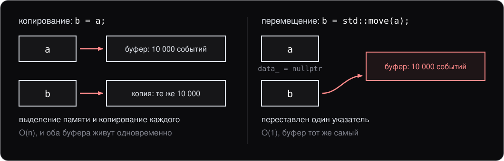
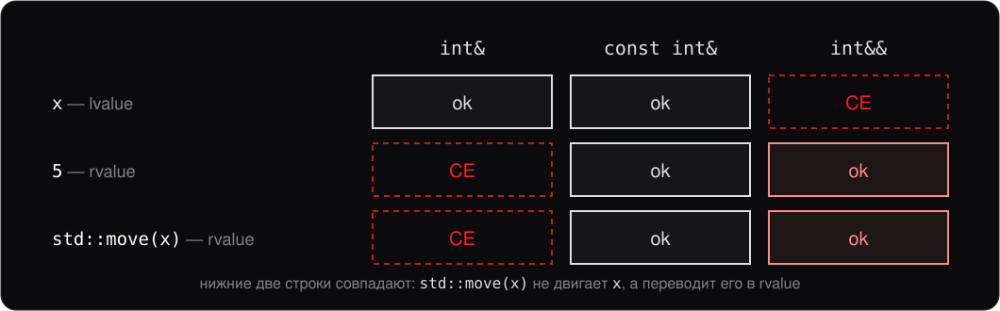
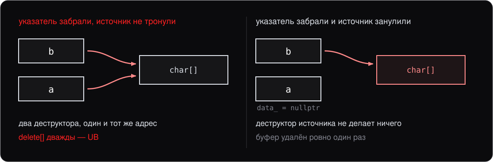
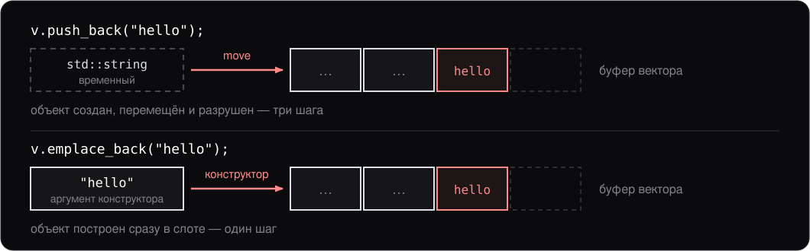
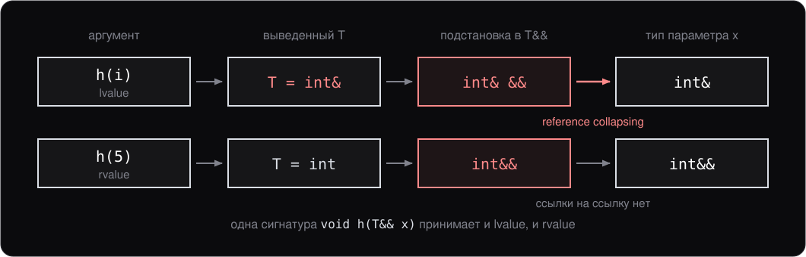
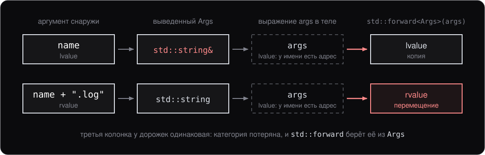
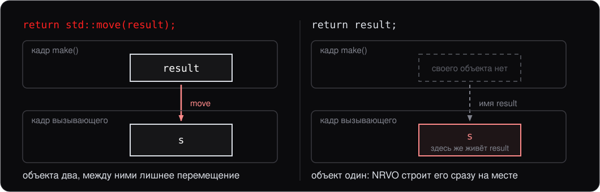

<style>
section {
    font-size: 25px;
}
</style>

<!-- _class: lead -->

# Лекция 11.

## Move-семантика и идеальная передача

---

# План

1. Проблема: лишнее копирование
2. `std::move` как инструмент
3. Категории значения и rvalue-ссылка
4. Move-конструктор
5. Move-`operator=`
6. Правило пяти и специальные функции-члены
7. `emplace_back` — конструирование на месте
8. `std::forward` — отдать дальше тем же, чем получили
9. Когда **не** надо писать `std::move`

---
<!-- header: 1. Проблема -->

# 1. Проблема: лишнее копирование

Классическая реализация `swap`:

```cpp
template <typename T>
void swap(T& a, T& b) {
    T tmp = a;        // копия
    a = b;            // копия
    b = tmp;          // копия
}
```

Для `T = std::vector<int>` размером миллион — **три полных копирования миллиона элементов**.

А ведь мы просто меняем местами! Содержимое никому новое не нужно.

---

## Ещё пример

```cpp
// собрали пачку событий из буфера ядра
std::vector<Event> read_batch() {
    std::vector<Event> batch;
    /* ... заполнили ... */
    return batch;
}

std::vector<std::vector<Event>> pending;
pending.push_back(read_batch());   // копирование всей пачки?!
```

`read_batch()` вернул временный вектор. Он **копируется** в `pending`, потом разрушается. Зачем копировать десять тысяч событий, если оригинал всё равно сейчас умрёт?

Хочется механизм «переложить ресурс» вместо «скопировать его».

---
<!-- header: 2. std::move -->

# 2. `std::move` как инструмент

C++11 ввёл **move-семантику** (move semantics) — передачу ресурсов без копирования:

```cpp
template <typename T>
void swap(T& a, T& b) {
    T tmp = std::move(a);
    a = std::move(b);
    b = std::move(tmp);
}
```

---

## Что переставляется вместо копирования



Для `std::vector` перемещение — это **три перестановки трёх указателей**: `O(1)` вместо `O(n)`.

---

## Что остаётся в источнике

```cpp
std::string s = "hello";
std::string t = std::move(s);   // ресурс уехал в t

// s теперь "valid but unspecified" — обычно пустая
std::cout << s.size();           // ok, легально (обычно 0)
s = "new value";                 // ok, можно присваивать
```

После `std::move(s)` объект `s` в состоянии **valid but unspecified**: использовать его содержимое до переприсваивания не стоит.

---
<!-- header: 3. Категории значения -->

# 3. Категории значения и rvalue-ссылка

Выражения делятся на две основные категории значения (value categories):

- **lvalue** — то, у чего есть **имя** и **адрес**. Может стоять слева от `=`.
- **rvalue** — временное значение. Литерал, результат функции, результат арифметики.

```cpp
int x = 5;             // x — lvalue, 5 — rvalue
int y = x + 1;         // y — lvalue, x+1 — rvalue
foo();                 // вызов функции — rvalue (если не возвращает T&)
```

**Rvalue → потенциально умрёт прямо сейчас → можно переиспользовать.** Узнать, что пришло rvalue, позволяет rvalue-ссылка (rvalue reference).

---

## Rvalue-ссылка `T&&`

Новый вид ссылки (rvalue reference, C++11) — привязывается **только к rvalue**:

```cpp
int x = 5;
int&& a = 5;        // ok: литерал — rvalue
int&& b = x + 1;    // ok: результат арифметики — rvalue
int&& c = x;        // CE: x — lvalue
```

Зачем: перегрузка (overloading) различает аргумент по категории значения.

```cpp
void take(const std::string& s);   // чужое: только читать или копировать
void take(std::string&& s);        // временное: можно забрать содержимое
```

---

## Что к чему привязывается



`const T&` принимает что угодно — поэтому им и пишут параметры «только почитать». Выбор между copy- и move-перегрузкой делает третья колонка.

---

## `std::move` — просто каст

`std::move` **не двигает ничего сам**. Это каст (cast) к rvalue-ссылке:

```cpp
std::string t = std::move(s);
// ровно то же самое:
// std::string t = static_cast<std::string&&>(s);
```

Выражение по-прежнему обозначает объект `s`, но стало rvalue — и перегрузка выбирает `std::string(std::string&&)`.

Перемещает **move-конструктор** (move constructor), а `std::move` только разрешает ему это сделать.

---

## Имя rvalue-ссылки — lvalue

```cpp
int&& r = 5;
int&& r2 = r;      // CE: выражение r — lvalue
int& r3 = r;       // ok
```

**Подвох:** у `r` есть имя и адрес — значит, выражение `r` уже lvalue. `&&` в объявлении говорит только о том, к чему ссылку можно было привязать.

Это правило вернётся в разделе 8.

---
<!-- header: 4. Move-конструктор -->

# 4. Move-конструктор

Move-конструктор (move constructor) — конструктор от **rvalue-ссылки** на свой тип:

```cpp
class String {
    char* data_ = nullptr;
    size_t size_ = 0;
public:
    String(const String& other);     // копирующий (как раньше)

    String(String&& other) noexcept  // move-конструктор — новый
        : data_(other.data_), size_(other.size_) {
        other.data_ = nullptr;
        other.size_ = 0;
    }
};
```

---

## Зачем зануляют источник



Забрать указатель — половина дела. Пока источник помнит тот же адрес, оба деструктора его удалят.

---

## Когда вызовется move

```cpp
String a("hello");
String b = a;               // копирующий (a — lvalue)
String c = std::move(a);    // move-конструктор (std::move делает a rvalue)

std::vector<String> v;
v.push_back(String("hi"));  // move-конструктор (временный объект — rvalue)
```

Компилятор выбирает между `String(const String&)` и `String(String&&)` по тому, из чего создаётся объект: из lvalue или из rvalue.

---

## `noexcept` обязателен (почти)

```cpp
String(String&& other) noexcept { /*...*/ }
```

Без `noexcept` `std::vector` при перевыделении будет **копировать** элементы вместо move. Причина — strong exception safety (разберём на лекции 14).

**Правило:** **всегда** помечайте move-конструктор `noexcept`, если он реально не бросает.

---
<!-- header: 5. Move = -->

# 5. Move-`operator=`

```cpp
class String {
public:
    String& operator=(String&& other) noexcept {
        if (this == &other) return *this;

        delete[] data_;              // освобождаем своё
        data_ = other.data_;          // забираем чужое
        size_ = other.size_;
        other.data_ = nullptr;
        other.size_ = 0;

        return *this;
    }
};
```

Тоже `noexcept`, тоже зануляет источник.

---

## Через copy-and-swap (короче, но не оптимально)

```cpp
String& operator=(String other) noexcept {
    swap(*this, other);
    return *this;
}
```

Один метод закрывает и copy, и move (компилятор выберет, какой конструктор вызвать для параметра `other`). Цена — лишний swap для случая copy, для move — оптимально.

В критичном коде пишут отдельные `operator=(const String&)` и `operator=(String&&)`. В обычном — copy-and-swap проще.

---
<!-- header: 6. Правило пяти -->

# 6. Правило пяти и специальные функции-члены

Пять специальных функций-членов (special member functions) компилятор генерирует сам:

1. Конструктор по умолчанию (default constructor) — `T()`
2. Копирующий конструктор (copy constructor) — `T(const T&)`
3. Копирующее присваивание (copy assignment) — `T& operator=(const T&)`
4. Move-конструктор — `T(T&&)`
5. Move-присваивание (move assignment) — `T& operator=(T&&)`

Плюс деструктор (`~T()`). Как с ними обращаться, говорит правило пяти (rule of five).

---

## Правило пяти

Написали **хотя бы один из пяти** — осознанно решите про **остальные** (часто `= default` / `= delete`).

Особенно: если вы написали **свой деструктор**, компилятор **не сгенерирует** move-функции автоматически. Класс будет копироваться по полям — а вы, возможно, хотели move.

```cpp
class Buffer {
public:
    ~Buffer() { delete[] data_; }
    Buffer(Buffer&&) noexcept = default;
    Buffer& operator=(Buffer&&) noexcept = default;
    // ... копирующие конструктор и operator= руками
};
```

---

## Правило нуля

**Самое важное правило:** если ваш класс **не владеет ресурсом напрямую** (ownership), не пишите **ничего из пятёрки**.

Поля вроде `std::vector`, `std::string`, `std::unique_ptr` сами умеют правильно копироваться и перемещаться. Компилятор сгенерирует за вас правильное поведение.

```cpp
class Profile {
    std::string name_;
    std::vector<int> scores_;
    // вообще ничего не пишем — всё работает само
};
```

Большинство хороших C++-классов следуют именно этому правилу.

---
<!-- header: 7. emplace_back -->

# 7. `emplace_back` — конструирование на месте

```cpp
std::vector<std::string> v;
v.push_back("hello");          // создание временного string + move
v.emplace_back("hello");       // создание string прямо в векторе
```

`emplace_back` принимает аргументы **конструктора** элемента и конструирует его **на месте**, без временного объекта (temporary object).

В новом коде предпочитайте `emplace_back`/`emplace` — обычно эффективнее и короче.

---

## Где конструируется элемент



То же и с конструктором от нескольких аргументов: `v.emplace_back(3, 4)` вызывает `Point(3, 4)` в слоте вектора, а `v.push_back(Point(3, 4))` — рядом с ним.

---
<!-- header: 8. std::forward -->

# 8. `std::forward` — отдать дальше тем же, чем получили

```cpp
template <typename T, typename... Args>
std::unique_ptr<T> my_make_unique(Args... args) {   // лекция 9
    return std::unique_ptr<T>(new T(args...));
}

auto p = my_make_unique<std::string>(name + ".log");
```

`args` — имя, значит lvalue (раздел 3), и `new T(args...)` всегда копирует. Временную строку копировать незачем — она сейчас умрёт. Именованная копируется дважды: в параметр и в `T`.

---

## Forwarding reference

```cpp
template <typename T, typename... Args>
std::unique_ptr<T> my_make_unique(Args&&... args) {
    return std::unique_ptr<T>(new T(args...));   // всё ещё copy
}
```

Ссылка убирает копию на входе. `Args&&` здесь — не rvalue-ссылка: `Args` выводится из этого же параметра, и такой `T&&` называется **forwarding reference** (у Мейерса — universal reference).

Информация о том, чем был аргумент, записана в `Args`. Теряется она в теле: имя ссылки — lvalue.

---

## Как выводится `T&&`



Для lvalue `T` выводится ссылкой, и подстановка даёт `int& &&`. Ссылку на ссылку сворачивает **reference collapsing**: есть хоть одна `&` — получается `&`. Так одна функция принимает и lvalue, и rvalue.

---

## `std::move` здесь неверен

```cpp
return std::unique_ptr<T>(new T(std::move(args)...));   // ПЛОХО
```

`std::move` безусловен: он сделает rvalue и из именованного объекта вызывающего.

```cpp
std::string name = "agent";
auto p = my_make_unique<std::string>(name);   // name опустошён
```

Вызывающий не писал `std::move` и отдавать ресурс не собирался.

---

## Условный каст (cast)

```cpp
return std::unique_ptr<T>(new T(std::forward<Args>(args)...));
```



**Правило:** `std::forward` — условный `std::move`. Перемещает только то, что и снаружи было временным.

---

## Замер: что дал `std::forward`

`T = std::string`, счётчики в копирующем конструкторе и move-конструкторе:

| аргумент | `Args...` (лекция 9) | `Args&&` + `std::forward` |
|---|---|---|
| временный: `name + ".log"` | 1 копия | 0 копий, 1 перемещение |
| именованный: `name` | 2 копии | 1 копия |

Временный объект больше не копируется, именованный копируется один раз. Так и объявлен настоящий `std::make_unique`.

---

## Как это писать

**Правило:** `std::forward<T>` — только там, где `T` **выведен** из параметра `T&&`, и один раз на аргумент.

```cpp
std::forward(args)...       // CE: тип обязателен
sink(std::forward<T>(x));
sink(std::forward<T>(x));   // второй раз — уже опустошённое
```

```cpp
template <typename T>
class Holder {
    void set(T&& value);    // НЕ forwarding reference
};
```

Стоит за `make_unique`, `make_shared`, `emplace_back`.

---
<!-- header: 9. RVO -->

# 9. Когда **не** надо писать `std::move`



**NRVO** (named return value optimization): возвращаемый объект строится сразу в памяти вызывающей стороны. Для временного (`return std::string("hi")`) с C++17 это гарантия стандарта, для именованной переменной — разрешённая оптимизация, которую делают все основные компиляторы.

---

## Когда `std::move` нужен

- Передаём что-то дальше, что не вернётся: `set(std::move(value))`
- Извлекаем из контейнера: `auto x = std::move(v.back()); v.pop_back();`
- Move в `swap`: `auto tmp = std::move(a); a = std::move(b); b = std::move(tmp);`

---

## Когда `std::move` НЕ нужен

- `return local_var;` — компилятор сделает RVO
- `return expression;` — это уже rvalue

**Привычка:** не пишите `std::move` на `return` локальной переменной. Если сомневаетесь — компилятор подскажет warning'ом (`-Wpessimizing-move`).

---
<!-- header: Итоги -->

# Итоги лекции

- **Move-семантика** даёт **переместить ресурс** вместо копирования. Для `vector` — `O(1)` вместо `O(n)`.
- **`std::move(x)`** — каст к rvalue-ссылке `T&&`: не двигает, а превращает **lvalue** в **rvalue** и тем **разрешает** забрать ресурс.
- **Move-функции** забирают ресурс и **зануляют** источник. Без `noexcept` STL копирует.
- **Правило пяти:** написали один — подумайте про остальные. **Правило нуля:** обычно не пишите ничего.
- **`emplace_back`** конструирует на месте — экономит один move/copy.
- **`T&&` с выводимым `T`** — forwarding reference: для lvalue `T = int&`, и `int& &&` схлопывается в `int&`.
- **`std::forward<T>(x)`** — условный `std::move`: перемещает только то, что и снаружи было rvalue.
- **На `return` локальной переменной `std::move` НЕ нужен** — компилятор сделает RVO.

---

# Дальше

Следующая — **`auto` и `decltype`: кто пишет типы**:

- `auto` как делегирование: тип очевиден — не пишем
- Цена: `auto` *упрощает* тип, срезая `const` и `&`
- `decltype` — узнать тип, не называя его
- `decltype(auto)` — синтез обоих

В курс не входит:

- Ref-qualifier у методов (`void m() &`, `void m() &&`)
- Полная классификация категорий значения

