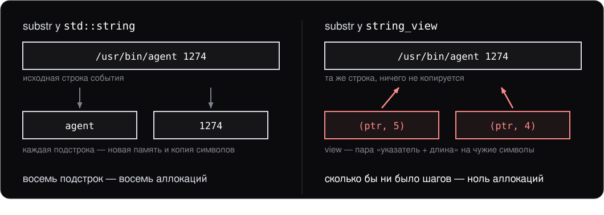
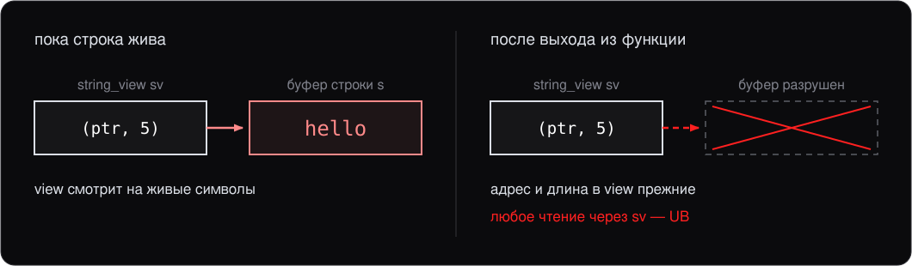
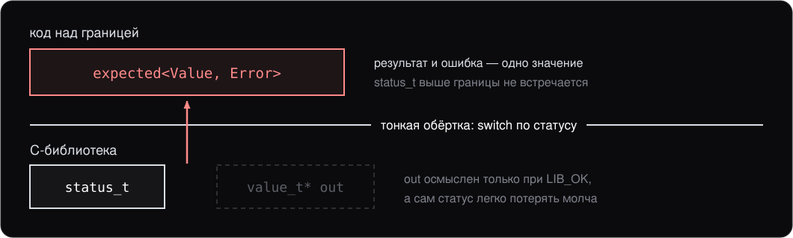
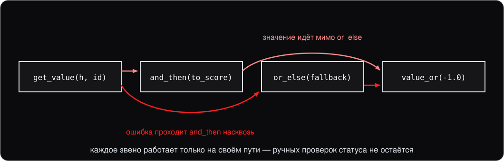

# Лекция 14. Утилитарные типы и обработка ошибок

> Конспект к лекции для самостоятельного чтения. Слайды (`slides.md`) повторяют структуру, конспект подробнее объясняет «почему».

## 0. О чём эта лекция

Синтаксис языка к этому моменту пройден почти целиком. Но в любом современном production-проекте на C++ встречается одна и та же группа **утилитарных типов** — небольших, идиоматичных и очень частых. Появились они недавно: `string_view` и `optional` — в C++17, `span` — в C++20, `expected` — в C++23.

Вторая половина лекции возвращается к теме, начатой на лекции 3. Там мы разобрали два способа сообщить об ошибке — код возврата и исключение — и отложили третий, потому что он требовал шаблонов. Теперь шаблоны есть, и мы этот долг закрываем: разберём `std::expected`, сравним все три подхода и научимся выбирать между ними осознанно.

Темы:

- `std::string_view` и `std::span` — невладеющие view.
- `std::optional` — «значение или ничего».
- `std::expected` — «значение или ошибка».
- Сравнение трёх механизмов обработки ошибок и критерии выбора.
- Отображение кодов возврата C-библиотеки в `expected`.
- `std::error_code`.

К концу лекции вы должны:

- Понимать, какую дыру старого C++ закрывает каждый из четырёх типов, и уметь их применять.
- Знать общий подвох `string_view` и `span` — время жизни источника.
- Уметь выбрать механизм ошибок под ситуацию и удерживать один механизм на слой.
- Заворачивать чужой C-API с кодами возврата в `std::expected`.

## 1. Зачем нам эти типы

Классов, шаблонов, лямбд и контейнеров уже достаточно, чтобы писать рабочий код. Но в любом современном проекте на C++ встречается одна и та же небольшая группа [утилитарных типов](../glossary.md#vocabulary-types) (vocabulary types), и каждый из них закрывает ровно одну дыру старого языка:

| Что раньше приходилось делать неудобно | Чем закрывается |
|---|---|
| передать строку в функцию, не копируя её | `std::string_view` |
| передать массив, не потеряв длину | `std::span` |
| вернуть «значение или ничего» | `std::optional` |
| вернуть «значение или ошибку» | `std::expected` |

Все четыре — маленькие типы без собственной сложности: разобравшись с одним, остальные читаются по аналогии. Общего у них два свойства. Во-первых, они **явные**: тип в [сигнатуре](../glossary.md#signature) (signature) сам говорит, чего от функции ждать, и это перестаёт быть договорённостью в комментарии. Во-вторых, у первых двух есть общий подвох — они ничем не [владеют](../glossary.md#ownership) (ownership), и [время жизни](../glossary.md#lifetime) (lifetime) источника целиком на вас.

Вторая половина лекции — про обработку ошибок. К этому моменту в распоряжении три конкурирующих механизма: коды возврата, исключения и result-типы. Разберём, чем они отличаются, и как переводить чужие коды возврата в `expected` на границе с C-API.

## 2. `std::string_view`

### Почему `const std::string&` не всегда подходит

Допустим, мы написали функцию, которая читает строку:

```cpp
size_t count_dots(const std::string& s) {
    size_t result = 0;
    for (char c : s) if (c == '.') ++result;
    return result;
}
```

И вызываем её так:

```cpp
count_dots("hello.world");
```

Это скомпилируется. Но что произошло? Компилятор увидел, что в функцию ожидают `const std::string&`, а у нас `const char*`. У `std::string` есть конструктор от `const char*`, поэтому компилятор сконструировал **временный `std::string`** из C-строки. Конструктор `std::string` обычно делает **аллокацию в [куче](../glossary.md#heap) (heap)** — если строка не помещается во встроенный буфер [SSO](../glossary.md#sso) (small string optimization). После возврата из функции [временный объект](../glossary.md#temporary) (temporary object) уничтожится — память освободится.

То есть на каждый вызов такой функции с C-строкой мы платим malloc + free. Если функция действительно «просто читать», это лишние накладные расходы.

На одном вызове это звучит как придирка: аллокация — операция порядка десятков наносекунд, кто её заметит. Заметно становится, когда таких вызовов много. Разберём случай, где это перестаёт быть теорией.

Агент получает от системы события в текстовом виде — строка с путём к исполняемому файлу, именем процесса, идентификатором, командной строкой. Разбор одного события — это пять-десять операций «вырезать подстроку и посмотреть, что в ней»:

```cpp
Event parse(const std::string& line) {
    std::string path = line.substr(0, line.find(' '));      // аллокация
    std::string name = path.substr(path.rfind('/') + 1);    // аллокация
    // ... и так ещё несколько раз
}
```

Каждый `std::string::substr` возвращает **новую строку**, то есть делает аллокацию и копирует символы. Пусть их восемь на событие, а событий — 20 000 в секунду:

```
8 × 20 000 = 160 000 аллокаций в секунду
```

Причём ни одна из этих копий никому не нужна дольше, чем длится разбор: нам надо было всего лишь *посмотреть* на символы, которые уже лежат в памяти в исходной строке. Мы копируем данные, чтобы прочитать данные.

Это и есть общая форма проблемы, а не только про телеметрию: любой парсер, любая обработка текста в цикле, любая функция вида «дай мне строку, я её проверю» страдает от того же самого. Нужен тип, который умеет представлять «участок символов» без владения им.

### Что такое `string_view`

В C++17 появился `std::string_view`. Это **не строка, а [view](../glossary.md#view)** (non-owning view) — невладеющее представление строки: внутри хранится `const char*` и `size_t`. Никакой аллокации.

```cpp
size_t count_dots(std::string_view s) {
    size_t result = 0;
    for (char c : s) if (c == '.') ++result;
    return result;
}

count_dots("hello.world");           // ok, без аллокации
std::string s = "hello.world";
count_dots(s);                       // ok, без аллокации
```

`string_view` неявно конструируется из `const char*` и из `std::string`. У него есть практически весь интерфейс строки на чтение: `size`, `empty`, `find`, `substr`, `==`, `<`, итераторы. При этом `substr` тоже возвращает `string_view` — то есть **взятие подстроки — это `O(1)` без копирования**, что для обычной `std::string::substr` неверно.

Последнее свойство и решает проблему парсера, с которой начался раздел. Тот же разбор события, переписанный на `string_view`:

```cpp
Event parse(std::string_view line) {
    std::string_view path = line.substr(0, line.find(' '));
    std::string_view name = path.substr(path.rfind('/') + 1);
    // ... сколько бы ни было шагов — ноль аллокаций
}
```



Копия понадобится только там, где данные нужно **сохранить** дольше, чем живёт исходная строка, — и там мы её сделаем осознанно, сконструировав `std::string` из view.

### Подводные камни `string_view`

`string_view` — это **ссылка**. К ней применимы те же правила, что и к `const std::string&`: если view переживает свой источник, получается [висячая ссылка](../glossary.md#dangling) (dangling reference).

```cpp
std::string_view bad() {
    std::string s = "hello";
    return s;   // s умрёт здесь, view ссылается на мёртвую память
}
```



Ещё одна неочевидная вещь: **`string_view` не гарантирует null-терминированность**. У `std::string::c_str()` есть гарантия, что в конце стоит `\0`. У `string_view` — нет: вы можете отрезать подстроку посередине, и `s.data()` будет указывать в середину чужой памяти. Поэтому **в C-API (`printf`, `open`, `fopen`) `string_view` напрямую передавать нельзя**, его сначала нужно скопировать в `std::string`.

**Правило:** `string_view` — для аргументов функций, которые только читают строку. Не для возврата, не для хранения в полях класса (если только класс не «живёт меньше», чем источник).

## 3. `std::span` (C++20)

### Как принять произвольный массив

Та же история, что со строками, только с массивами. Как написать функцию, которая принимает массив? До C++20 было три плохих варианта:

```cpp
void print(const int* arr, size_t n);             // C-стиль, легко рассогласовать
void print(const std::vector<int>& v);            // только vector
template <typename Container>
void print(const Container& c);                   // шаблон, header-only
```

Первый плох тем, что длина передаётся отдельным параметром — её легко забыть, неправильно посчитать, перепутать. Второй слишком узкий: работает только с `vector`, для `array` или сырого массива нужна другая [перегрузка](../glossary.md#overload) (overloading). Третий заставляет помещать тело функции в заголовок.

### Что такое `span`

`std::span<T>` — это пара `(T*, size_t)`. Принимает любой непрерывный массив:

```cpp
void print(std::span<const int> s) {
    for (int x : s) std::cout << x << ' ';
}

int arr[5] = {1, 2, 3, 4, 5};
std::vector<int> v = {6, 7, 8};
std::array<int, 3> a = {9, 10, 11};

print(arr);  // ok
print(v);    // ok
print(a);    // ok
```

### Static vs dynamic extent

У `span` есть второй шаблонный параметр — размер на этапе компиляции:

```cpp
std::span<int>           // dynamic extent, размер в рантайме
std::span<int, 5>        // static extent, ровно 5 элементов
```

С static extent компилятор проверяет, что вы передаёте именно столько элементов, сколько обещали. На практике static extent встречается редко: обычно функции принимают массив произвольной длины.

### Подводный камень `span`

Тот же, что и у `string_view`: **`span` не владеет**. Срок жизни источника должен быть больше, чем срок жизни span.

```cpp
std::span<int> s = std::vector<int>{1, 2, 3};   // временный vector умрёт сейчас же
```

## 4. `std::optional` (C++17)

### Что вернуть, если результата нет

Очень частая ситуация: функция «может вернуть значение, а может не вернуть». Парсинг строки в число, поиск в контейнере, чтение из неблокирующего источника.

До C++17 это решалось плохо:

- **Магическое значение**: `int parse_int()` возвращает `-1` при ошибке. Проблема: `-1` может быть валидным результатом для какого-нибудь арифметического выражения.
- **Out-параметр + bool**: `bool parse_int(sv, int& out)`. Некрасиво и легко забыть проверить возвращаемое значение.
- **Исключение**: дорого для **ожидаемого** отсутствия результата. «Строка не является числом» — это не исключительная ситуация, а часть нормальной логики парсера.

### Что такое `optional`

`std::optional<T>` хранит либо значение типа `T`, либо ничего:

```cpp
#include <optional>
#include <charconv>

std::optional<int> parse_int(std::string_view s) {
    int result;
    auto [ptr, ec] = std::from_chars(s.data(), s.data() + s.size(), result);
    if (ec != std::errc{}) return std::nullopt;
    return result;
}

if (auto x = parse_int("42")) {
    std::cout << *x;
} else {
    std::cout << "not a number";
}
```

### Что внутри `optional`

`optional<T>` — это **буфер под `T`** (без аллокации в куче) плюс флаг `bool`:

```cpp
template <typename T>
class optional {
    alignas(T) std::byte storage_[sizeof(T)];
    bool has_value_ = false;
    // ...
};
```


Когда нужно положить значение, `T` конструируется в буфер через **placement new** — техника, на которой держится, в частности, `vector::reserve`; когда нужно убрать — деструктор `T` вызывается явно. Главное практическое следствие: `optional<int>` стоит примерно `sizeof(int) + sizeof(bool) + padding`.

### Интерфейс `optional`

| Метод | Что делает |
|---|---|
| `has_value()` / `operator bool` | есть ли значение |
| `value()` | значение; бросает `bad_optional_access`, если нет |
| `*` / `->` | как `value()`, но **[UB](../glossary.md#ub)** (undefined behavior) при отсутствии (как у указателей) |
| `value_or(default)` | значение или запасное значение |
| `reset()` | сделать пустым |
| `emplace(args...)` | сконструировать значение in-place |

```cpp
auto x = parse_int("nope");
int n = x.value_or(0);   // 0
```

### Монадические операции `optional` (C++23)

В C++23 у `optional` появились **монадические** методы — для функциональной композиции без вложенных `if`:

```cpp
auto result = parse_int("21")
        .and_then([](int x) -> std::optional<int> { return x * 2; })
        .transform([](int x) { return x + 1; });
// result == optional{43}
```

- `and_then(f)` — применить `f`, если есть значение; `f` сама возвращает `optional`
- `transform(f)` — применить `f` к значению; `f` возвращает обычный тип, результат заворачивается обратно
- `or_else(f)` — выполнить альтернативу, если значения нет

Это удобно для цепочек обработки «если получилось, сделай ещё шаг».

## 5. `std::expected` (C++23)

### Значение или причина ошибки

`optional<T>` хорош, но он отвечает только на вопрос «есть значение или нет», а часто хочется ещё и сказать, **почему** нет. Информация об ошибке.

Варианты до C++23:

- Бросить исключение — иногда дорого, иногда нельзя (`-fno-exceptions`)
- Вернуть `pair<bool, T>` — некрасиво и легко проигнорировать
- Использовать `tl::expected` или `boost::outcome` — сторонние библиотеки

В C++23 это стало стандартом как `std::expected<T, E>`.

### Возврат `expected` из парсера

```cpp
#include <expected>

enum class ParseError { Empty, NotANumber, Overflow };

std::expected<int, ParseError> parse_int(std::string_view s) {
    if (s.empty()) return std::unexpected(ParseError::Empty);

    int result;
    auto [ptr, ec] = std::from_chars(s.data(), s.data() + s.size(), result);
    if (ec == std::errc::result_out_of_range)
        return std::unexpected(ParseError::Overflow);
    if (ec != std::errc{})
        return std::unexpected(ParseError::NotANumber);

    return result;
}

auto x = parse_int("nope");
if (!x) {
    std::cerr << "error code: " << static_cast<int>(x.error());
}
```

### Интерфейс `expected`

Очень похож на `optional`, плюс отдельный метод для ошибки:

| Метод | Что делает |
|---|---|
| `has_value()` / `operator bool` | успех |
| `value()` | значение; бросает `bad_expected_access` при ошибке |
| `error()` | ошибка |
| `value_or(default)` | значение или запасное значение |
| `*` / `->` | как `value()`, UB при ошибке |

Плюс монадические `and_then`, `or_else`, `transform`, `transform_error` — для функциональной композиции.

### Если стандарта пока нет

В реальных проектах вы скорее столкнётесь с:

- **`tl::expected`** (Sy Brand) — header-only реализация, де-факто стандартом до C++23
- **`boost::outcome`** — у Boost
- **`absl::StatusOr<T>`** — у Google

## 6. Третий подход и выбор между ними

На лекции 3 мы разобрали два способа сообщить о неудаче: **код возврата** и **исключение**. Тогда же было сказано, что есть третий, но он требует шаблонов. Теперь шаблоны есть, `optional` и `expected` разобраны — можно выложить все три рядом.

Начнём с главного вывода, чтобы он не потерялся в деталях: **ни один из трёх не является «правильным» в отрыве от контекста**. Каждый правильный для своих ситуаций, и выбор делается под задачу, а не по общему предпочтению команды или языковой моде.

### Что мы уже знаем про первые два

Коротко освежим, теперь уже с точки зрения сравнения.

**Код возврата** ничего не стоит, работает везде, включая сборки без поддержки исключений, и делает поток управления полностью явным. Платит за это тем, что его легко проигнорировать (компилятор молчит), что результат и ошибка живут в одном типе, и что через несколько уровней стека ошибку приходится протаскивать руками.

**Исключение** решает последнюю проблему целиком: обработчик может стоять сколь угодно далеко, промежуточные функции ничего не знают. Его нельзя случайно проигнорировать — непойманное исключение завершает программу. Платит за это невидимостью потока управления (любой вызов может бросить), стоимостью самого броска и невозможностью работать под `-fno-exceptions`.

Обратите внимание на общую слабость обоих, которая до сих пор не проговаривалась явно:

```cpp
int  parse_port(const std::string& s);      // может вернуть -1? бросить? непонятно
Config load_config(std::string_view path);  // бросает? а что именно?
```

**Из сигнатуры не видно, что функция может не сработать.** У кода возврата это знание живёт в документации, у исключений — в реализации и в реализации всего, что она вызывает. Ни компилятор, ни IDE, ни человек, читающий заголовок, не получают предупреждения.

### Что добавляет result-тип

Ровно это и чинит:

```cpp
std::expected<Config, ParseError> load_config(std::string_view path);
```

Сигнатура теперь говорит всё: функция вернёт либо `Config`, либо `ParseError`, и вызывающий обязан разобраться, что именно. Забыть проверку трудно: разыменование `*result` без проверки — UB, а `[[nodiscard]]` (лекция 5) не даст молча выкинуть результат целиком. Ошибка стала частью **типа**, а тип проверяет компилятор.

**Плюсы:** ошибка явно в сигнатуре; поток управления остаётся видимым; работает под `-fno-exceptions`; хорошо ложится на библиотечные API, где автор не знает, как вызывающий захочет обработать неудачу.

**Минусы** тоже есть, и их стоит знать до того, как захочется переписать на `expected` вообще всё.

Первый — код обрастает лесенкой проверок:

```cpp
auto data = read_file(path);
if (!data) return std::unexpected(data.error());

auto parsed = parse(*data);
if (!parsed) return std::unexpected(parsed.error());

auto validated = validate(*parsed);
if (!validated) return std::unexpected(validated.error());
```

Монадические `and_then` / `or_else` сглаживают это, но не устраняют полностью, особенно когда типы ошибок на разных этапах различаются.

Второй минус серьёзнее и часто упускается: **result-типы плохо масштабируются на «ошибка возникла пятью уровнями ниже»**. Посмотрите на код выше внимательно — это ровно тот ручной проброс, от которого спасали исключения, только записанный современнее. Если ошибку надо поднять через десять слоёв, каждый слой снова обязан о ней знать и правильно её передать.

Третий: конструкторы не умеют возвращать значения. Если объект не может быть создан, `expected` не поможет — там по-прежнему исключение или отложенная инициализация через фабричный метод.

### Когда что использовать

| Ситуация | Что использовать |
|---|---|
| Ошибка ожидаемая, локальная, восстановимая | `optional` / `expected` |
| Ошибка редкая, неустранимая, может произойти где угодно | исключения |
| Запрещены исключения (HFT, embedded, ядро) | коды возврата / `expected` |
| Системный API | коды возврата / `error_code` |
| Internal business logic | исключения **или** `expected` (стиль команды) |
| Парсеры, валидаторы | `expected` |
| Конструкторы | исключения (другого механизма нет) |

**Главное правило: внутри одного проекта или слоя используйте один подход последовательно.** Смесь — это худшее, что можно сделать: непонятно, ловить ли исключения или проверять возвращаемое значение, и легко пропустить ошибку.

### Как это выглядит на живой системе

Формулировка «один подход на слой» звучит абстрактно, пока не увидишь, как границы слоёв ложатся на реальную программу. Разберём агент защиты рабочей станции — в нём отчётливо видны три слоя с тремя разными ответами.


**Слой обращений к операционной системе.** Открыть устройство, подписаться на источник событий, прочитать блок данных. Здесь выбора почти нет: интерфейс системы сам разговаривает кодами возврата, и оборачивать каждый вызов в исключение — значит платить за это на каждом обращении и терять код ошибки, который потом понадобится в диагностике.

**Слой разбора событий — [горячий путь](../glossary.md#hot-path) (hot path).** Пришла строка телеметрии, её надо превратить в структуру. Битые, обрезанные и неожиданно отформатированные строки в потоке с реальной машины — не аварийная ситуация, а **данность**: источник может быть из другой версии ОС, событие могло обрезаться на границе буфера. Такое случается тысячи раз в сутки и не является поводом [раскручивать стек](../glossary.md#stack-unwinding) (stack unwinding). Здесь — `expected<Event, ParseError>`: функция честно объявляет в своём типе, что может не справиться, вызывающий обязан это учесть, а стоимость ошибки равна стоимости возврата структуры.

**Слой запуска и конфигурации.** Прочитать файл настроек, разобрать список включённых правил, поднять подсистемы. Это происходит один раз при старте, и если конфигурация битая — продолжать бессмысленно: агент с неизвестным набором правил хуже, чем агент, который честно не запустился. Здесь — исключения: ошибка редкая, неустранимая, и её удобно поймать в одном месте в `main`.

Обратите внимание, по какому признаку слои разошлись. Не по «где быстрее» — соблазнительно решить, что горячий путь получил `expected` из-за производительности, но это следствие, а не причина. Разошлись они по **ожидаемости ошибки**. Битая строка в бесконечном потоке — рутина, часть нормальной работы, и в типе функции ей место. Отсутствующий файл конфигурации — событие, после которого нормальной работы не будет вовсе, и его уместно вынести из основного кода в обработчик.

Это и есть практический способ применять правило: не спрашивайте «какой механизм лучше», спрашивайте «насколько эта ошибка — часть нормальной жизни моей функции».

## 7. Ошибки на границе с C-API

Предыдущее правило сразу упирается в практику: свой код можно держать в одном механизме, а вот сторонние C-библиотеки о нём не знают. Так выглядит любая обёртка над системной или сторонней C-библиотекой — например над библиотекой, отдающей поток событий с машины.

### Как выглядит типичный C-интерфейс

Типичная C-библиотека возвращает перечислимый статус, а результат кладёт в out-параметр:

```c
typedef enum {
    LIB_OK = 0,
    LIB_ERR_BAD_HANDLE = 1,
    LIB_ERR_NOT_FOUND = 2,
    LIB_ERR_IO = 3
} status_t;

typedef struct lib_handle handle_t;

typedef struct {
    int id;
    double payload;
} value_t;

status_t lib_get_value(handle_t* h, int id, value_t* out);
```

Интерфейс неудобен сразу по нескольким причинам. Результат и признак успеха разъехались: `out` осмыслен только тогда, когда вернулся `LIB_OK`, но компилятор этой связи не знает. Сам статус легко потерять — вызов `lib_get_value(h, id, &raw);` без проверки компилируется молча, и дальше код работает с неинициализированным `raw`. Наконец, `value_t` приходится завести заранее, ещё до того как известно, будет ли что в него класть.

### Тонкая обёртка

В C++-обёртке этот интерфейс превращается в `expected<T, Error>` — одно значение, в котором результат и ошибка не могут быть перепутаны:

```cpp
enum class Error { BadHandle, NotFound, Io, Unknown };

struct Value {
    int id;
    double payload;
};

[[nodiscard]] std::expected<Value, Error> get_value(handle_t* h, int id) {
    value_t raw{};
    switch (lib_get_value(h, id, &raw)) {
        case LIB_OK:             return Value{raw.id, raw.payload};
        case LIB_ERR_BAD_HANDLE: return std::unexpected(Error::BadHandle);
        case LIB_ERR_NOT_FOUND:  return std::unexpected(Error::NotFound);
        case LIB_ERR_IO:         return std::unexpected(Error::Io);
    }
    return std::unexpected(Error::Unknown);
}
```



Обёртка **тонкая**: она не добавляет логики, а только переводит статус в `Error` и складывает out-параметр в нормальный C++-тип.

### Цепочка вызовов

Дальше с результатом работают монадической цепочкой — ручных проверок статуса не остаётся:

```cpp
std::expected<double, Error> to_score(const Value& v);
std::expected<double, Error> fallback(Error e);

double read_score(handle_t* h, int id) {
    return get_value(h, id)
        .and_then(to_score)     // выполнится только при успехе
        .or_else(fallback)      // выполнится только при ошибке
        .value_or(-1.0);
}
```



Верхняя дорожка — [успешный путь](../glossary.md#happy-path) (happy path), нижняя — ошибка; `or_else` на ней может либо восстановиться (вернуть значение), либо вернуть `std::unexpected` с той же или другой ошибкой.

### Правила для обёрток над C

- **`[[nodiscard]]` на обёртке.** Исходный C-статус легко было проигнорировать; на обёртке этот атрибут возвращает проверку в обязательные — компилятор предупредит, если результат выброшен.
- **Статус нельзя терять.** Каждому коду библиотеки соответствует значение `Error`, а на неизвестные коды заведён `Error::Unknown`. Тогда добавление нового статуса в новой версии библиотеки не приведёт к молчаливому «успеху».
- **Один слой — один механизм.** Обёртка полностью скрывает `status_t`: коды возврата остаются на границе, а весь код над ней пользуется одним `expected`. Если часть функций слоя бросает исключения, часть возвращает коды, а часть — `expected`, то на каждом вызове приходится вспоминать, что именно проверять.

## 8. `std::error_code`

Параллельно со всем вышеперечисленным в стандартной библиотеке есть **`std::error_code`** — лёгкий объект из категории и числового кода:

```cpp
#include <filesystem>

std::error_code ec;
std::filesystem::create_directory("/path", ec);  // не бросает, пишет в ec
if (ec) {
    std::cerr << ec.message();   // человекочитаемое описание
    std::cerr << ec.value();     // числовой код
}
```

Многие функции стандартной библиотеки имеют две перегрузки: одна бросает исключение, другая принимает `error_code&` и пишет туда ошибку. Это типичный паттерн для системных API и асинхронного кода, где исключения нежелательны.

Подробно `error_code` мы не разбираем, но знать о его существовании надо — иначе сложно будет читать код, который использует `std::filesystem` или ASIO.

## Итоги

- **`string_view` / `span`** — невладеющие view для аргументов функций. Дают возможность принимать любые непрерывные данные без копирования. Следите за временем жизни источника — это ссылки.
- **`optional`** — «значение или ничего». Хранится как буфер + флаг, без аллокаций.
- **`expected`** (C++23) — «значение или ошибка», современный способ возвращать результат с подробной информацией об ошибке.
- **Три подхода к ошибкам** — коды возврата, исключения, result-типы. Каждый правильный для своих сценариев. Внутри одного слоя используйте один последовательно.
- **Граница с C-API** — статус C-библиотеки переводится в `expected` тонкой `[[nodiscard]]`-обёрткой, дальше работает монадическая цепочка `and_then` / `or_else`.
- **`std::error_code`** — есть и используется в системных API.

## Что дальше

Это последняя лекция курса. Последняя неделя отведена повторению пройденного.

За рамками курса осталось то, что стоит изучать дальше самостоятельно:

- **`std::variant` и `std::visit`** — [размеченное объединение](../glossary.md#tagged-union) (tagged union): значение одного из нескольких типов вместе с пометкой, какого именно.
- **[Exception safety](../glossary.md#exception-safety)** (по-русски — безопасность исключений) — что обещает функция, если бросила исключение: basic, strong и nothrow guarantee.
- **[Умные указатели](../glossary.md#smart-pointer) (smart pointers) изнутри** — [control block](../glossary.md#control-block) у `shared_ptr`, `weak_ptr` и циклические ссылки.
- **Многопоточность** — [потоки](../glossary.md#thread) (threads), [мьютексы](../glossary.md#mutex) (mutexes), [модель памяти](../glossary.md#memory-model) (memory model).
- **Метапрограммирование** — [SFINAE](../glossary.md#sfinae), `type_traits`, [концепты](../glossary.md#concept) (concepts) полностью.
- **Ranges глубоко, [аллокаторы](../glossary.md#allocator) (allocators), `constexpr` глубоко.**
