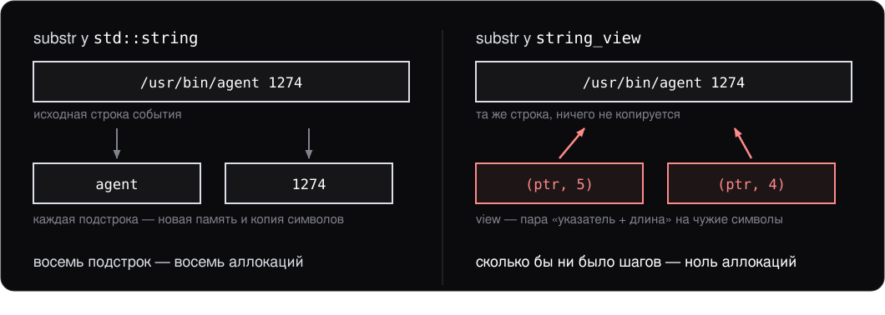
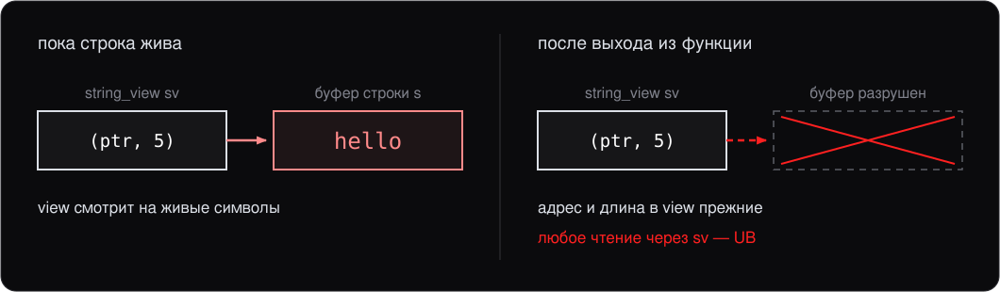
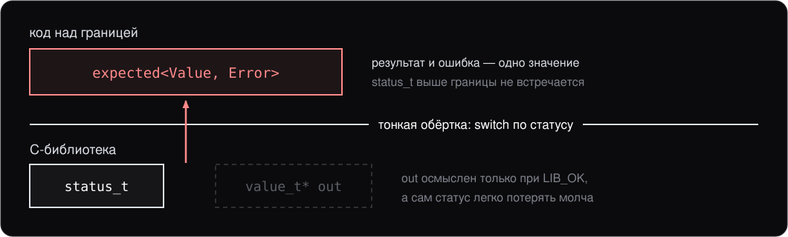
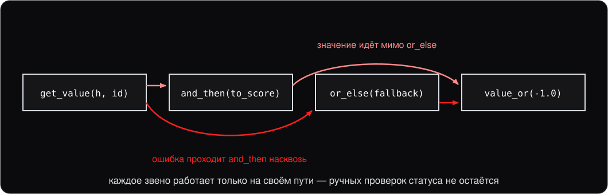

<style>
section {
    font-size: 25px;
}
</style>

<!-- _class: lead -->

# Лекция 14.

## Утилитарные типы и обработка ошибок

---

# План

1. Зачем нам эти типы
2. `std::string_view`
3. `std::span` (C++20)
4. `std::optional` (C++17)
5. `std::expected` (C++23)
6. Третий подход и выбор между ними
7. Ошибки на границе с C-API
8. `std::error_code`

---
<!-- header: 1. Зачем нам эти типы -->

# 1. Зачем нам эти типы

К этому моменту мы уже умеем писать классы, шаблоны, лямбды и пользоваться контейнерами — этого хватит, чтобы писать рабочий код. Но в современном production C++ почти всегда встречаются утилитарные типы (vocabulary types), закрывающие типичные дыры старого C++:

- «функция может вернуть значение, а может — не вернуть» — `optional`
- «передать строку в функцию, не копируя её» — `string_view`
- «передать массив в функцию, не теряя длину» — `span`
- «функция может вернуть либо результат, либо ошибку» — `expected`

---

## Обработка ошибок как отдельная тема

Последняя часть лекции — про **обработку ошибок**. К этому моменту в распоряжении три конкурирующих механизма: коды возврата, исключения и result-типы.

Разберём, чем они отличаются и как переводить чужие коды возврата в `expected` на границе с C-API.

---
<!-- header: 2. std::string_view -->

# 2. `std::string_view`

## Почему `const std::string&` не всегда подходит

```cpp
size_t count_dots(const std::string& s) {
    size_t result = 0;
    for (char c : s) if (c == '.') ++result;
    return result;
}

int main() {
    count_dots("hello.world");  // компилируется. Что произошло?
}
```

---

## Что происходит при вызове

При вызове `count_dots("hello.world")`:

1. Из C-строки `"hello.world"` сконструируется **временный `std::string`** (с аллокацией!)
2. Этот `std::string` передастся в функцию по `const&`
3. После возврата временный `std::string` уничтожится

Если функция действительно «просто прочитать строку» — это **лишний `malloc` на каждом вызове**. Хочется передавать любую последовательность символов без копирования.

---

## Почему «лишний malloc» — это много

Разбор одной строки телеметрии: вырезать путь, имя процесса, аргументы командной строки — пять-десять подстрок.

```cpp
Event parse(const std::string& line);   // и внутри ещё substr'ы
```

Каждая подстрока через `std::string::substr` — своя аллокация. Умножаем на поток событий:

```
8 аллокаций × 20 000 событий/с = 160 000 malloc/с
```

И всё это — чтобы **посмотреть** на символы, которые уже лежат в памяти. Ни одна из копий не нужна дольше, чем длится разбор.

---

## Что такое `string_view`

```cpp
#include <string_view>

size_t count_dots(std::string_view s) {
    size_t result = 0;
    for (char c : s) if (c == '.') ++result;
    return result;
}

int main() {
    count_dots("hello.world");           // ok, без аллокации
    std::string s = "hello.world";
    count_dots(s);                       // ok, без аллокации
}
```

`std::string_view` — это **non-owning view** над последовательностью `char`. Внутри это пара `(const char*, size_t)`, ничего не выделяется.

---

## Разбор строки без копий

Символы всё время лежат в одном месте — в исходной строке; функции передают друг другу пары «указатель, длина».



---

## Что важно знать про `string_view`

- Конвертируется из `const char*` и `std::string` неявно
- Имеет почти все методы строки: `size`, `empty`, `find`, `substr`, `==`, итераторы
- Копия нужна только там, где данные надо сохранить дольше исходной строки
- **Не гарантирует null-терминированности!** В функцию C-API передавать нельзя — там ждут `\0` в конце

---

## Главный подвох — время жизни (lifetime)

```cpp
std::string_view bad() {
    std::string s = "hello";
    return s;        // s умрёт здесь, а view останется
}
```



**Правило: `string_view` — для аргументов функций, которые «только читают» строку.**

---
<!-- header: 3. std::span -->

# 3. `std::span` (C++20)

## Как принять произвольный массив

Как написать функцию, которая принимает массив? До C++20 у нас было три плохих варианта:

```cpp
void print(const int* arr, size_t n);   // легко перепутать длину
void print(const std::vector<int>& v);  // только vector

template <typename Container>
void print(const Container& c);         // принимает что угодно, но шаблонная
```

Хочется: принимать **любой непрерывный массив**, не теряя длину и не быть шаблонным.

---

## Что такое `span`

```cpp
#include <span>

void print(std::span<const int> s) {
    for (int x : s) std::cout << x << ' ';
}
```

`std::span<T>` — это пара `(T*, size_t)`. Принимает массивы, `vector`, `array`, любой контейнер с contiguous памятью.

---

## `span` — единая перегрузка (overload) для всех

```cpp
int arr[5] = {1, 2, 3, 4, 5};
std::vector<int> v = {6, 7, 8};
std::array<int, 3> a = {9, 10, 11};

print(arr);   // ok
print(v);     // ok
print(a);     // ok
```

Одна функция принимает любой непрерывный массив — без шаблона и без потери длины.

---

## Static vs dynamic extent

```cpp
std::span<int>           // длина известна в рантайме (по умолчанию)
std::span<int, 5>        // длина фиксирована — ровно 5 элементов
```

С фиксированным размером — компилятор проверяет, что вы передали именно столько элементов, сколько обещали. На практике чаще используется dynamic extent.

**Подвох тот же, что и у `string_view`**: span не владеет данными, надо следить за временем жизни источника.

---
<!-- header: 4. std::optional -->

# 4. `std::optional` (C++17)

## Что вернуть, если результата нет

```cpp
int parse_int(std::string_view s) {
    // что вернуть, если строка — не число?
    return ???;
}
```

До C++17 у нас были плохие варианты:

- Возвращать «магическое значение» (`-1`, `INT_MIN`) — нельзя отличить от валидного результата
- Возвращать через out-параметр + `bool`: `bool parse_int(sv, int& out)` — некрасиво и легко проигнорировать
- Бросать исключение — дорого, и не подходит для **ожидаемого** отсутствия результата

---

## Что такое `optional`

```cpp
#include <optional>
#include <charconv>

std::optional<int> parse_int(std::string_view s) {
    int result;
    auto [ptr, ec] = std::from_chars(s.data(), s.data() + s.size(), result);
    if (ec != std::errc{}) return std::nullopt;
    return result;
}
```

`std::optional<T>` хранит либо значение типа `T`, либо ничего.

---

## Проверка и извлечение значения

```cpp
if (auto x = parse_int("42")) {
    std::cout << *x;             // 42
} else {
    std::cout << "not a number";
}
```

Если в `optional` есть значение — `operator bool` возвращает `true`, и до значения добираемся через `*` или `->`. Если нет — `false`.

---

## Что внутри `optional<T>`

Буфер под `T` плюс флаг: значение конструируется прямо в буфере через **placement new**.


`optional<int>` стоит ровно `sizeof(int) + sizeof(bool) + padding`.

---

## Интерфейс `optional`

- `has_value()` / `operator bool` — есть ли значение
- `value()` — кидает `std::bad_optional_access`, если нет
- `*` / `->` — UB, если нет (как у указателей)
- `value_or(default)` — значение или fallback
- `reset()` — сделать пустым
- `emplace(args...)` — сконструировать значение in-place
- `=` от `nullopt` или от `T` — переприсваивание

```cpp
auto x = parse_int("nope");
int n = x.value_or(0);   // 0
```

---

## Монадические операции `optional` (C++23)

```cpp
std::optional<int> parse_int(std::string_view s);
std::optional<int> double_it(int x) { return x * 2; }

auto result = parse_int("21")
        .and_then(double_it)                       // optional<int>
        .transform([](int x) { return x + 1; });   // optional<int> => 43
```

- `and_then(f)` — применить `f`, если есть значение; `f` возвращает `optional`
- `transform(f)` — применить `f` к значению; `f` возвращает обычный тип
- `or_else(f)` — выполнить альтернативу, если значения нет

Это **функциональный стиль** обработки опциональных значений. Без вложенных `if`.

---
<!-- header: 5. std::expected -->

# 5. `std::expected` (C++23)

## Значение или причина ошибки

`optional<T>` решает «значение или ничего». А если хочется «значение **или информация об ошибке**»?

- Можно бросить исключение — иногда дорого, иногда нельзя (HFT, embedded, `-fno-exceptions`)
- Можно вернуть пару `(bool, T)` — некрасиво и легко проигнорировать

В C++23 это узаконено как `std::expected<T, E>`.

---

## Возврат `expected` из парсера

```cpp
#include <expected>

enum class ParseError { Empty, NotANumber, Overflow };

std::expected<int, ParseError> parse_int(std::string_view s) {
    if (s.empty()) return std::unexpected(ParseError::Empty);

    int result;
    auto [ptr, ec] = std::from_chars(s.data(), s.data() + s.size(), result);
    if (ec == std::errc::result_out_of_range)
        return std::unexpected(ParseError::Overflow);
    if (ec != std::errc{})
        return std::unexpected(ParseError::NotANumber);

    return result;
}
```

---

## Интерфейс `expected`

- `has_value()` / `operator bool` — успех
- `value()` — значение, бросает `bad_expected_access` при ошибке
- `error()` — ошибка
- `value_or(default)` — значение или fallback
- `*`, `->` — как у `optional` (UB при ошибке)
- Монадические `and_then`, `or_else`, `transform`, `transform_error`

```cpp
auto x = parse_int("nope");
if (!x) {
    std::cerr << "error code: " << static_cast<int>(x.error());
}
```

---

## Что делать до C++23

Если стандарта пока нет:

- **`tl::expected`** (Sy Brand) — популярная header-only реализация
- **`absl::StatusOr<T>`** — у Google

К C++23 эта идея созрела достаточно, чтобы войти в стандарт. Если ваш проект на C++20 — обычно используют `tl::expected`.

---
<!-- header: 6. Подходы к обработке ошибок -->

# 6. Третий подход и выбор между ними

На лекции 3 мы разобрали два механизма: **код возврата** и **исключения**. Теперь у нас появился третий — **result-типы** (`optional`, `expected`).

Пора выложить их рядом и научиться выбирать. Спойлер: «лучшего» подхода не существует, каждый правильный для своих ситуаций.

---

## Напоминание: первые два

| | Код возврата | Исключение |
|---|---|---|
| Стоимость | ноль | throw дорог, без броска почти бесплатно |
| Можно проигнорировать | да, молча | нет, программа упадёт |
| Ошибка видна в сигнатуре | нет | нет |
| Через 5 уровней стека | тащить руками | сами |
| Работает с `-fno-exceptions` | да | нет |

Претензия к обоим одна: **из сигнатуры (signature) не видно, что функция может не сработать**.

---

## Что добавляет result-тип

```cpp
std::expected<Config, ParseError> load_config(std::string_view path);
```

Сигнатура говорит всё: функция вернёт либо конфиг, либо `ParseError`. Забыть проверку нельзя — `*` до проверки это UB, а `[[nodiscard]]` не даст выкинуть результат.

**Плюсы:** ошибка в типе; поток управления явный; нет `-fno-exceptions`-ограничений; хорошо для библиотечных API.

---

## Чем платим

```cpp
auto data = read_file(path);
if (!data) return std::unexpected(data.error());
auto parsed = parse(*data);
if (!parsed) return std::unexpected(parsed.error());
```

- **Код обрастает лесенкой проверок** — частично лечится монадическими `and_then` / `or_else`
- **Плохо масштабируется на «ошибка пятью уровнями ниже»** — вернулись к ручному пробросу, от которого спасали исключения
- Без `[[nodiscard]]` теряют половину своей ценности

---

## Когда что использовать

| Ситуация | Подход |
|---|---|
| Ожидаемая локальная ошибка | `optional` / `expected` |
| Редкая неустранимая «где угодно» | исключения |
| `-fno-exceptions` (HFT, embedded) | коды возврата / `expected` |
| Системный API | `error_code` |
| Парсеры, валидаторы | `expected` |
| Конструкторы | исключения |

---

## Главное правило

**Внутри одного проекта или слоя используйте один подход последовательно.**

Смешивать механизмы — самый плохой вариант: непонятно, ловить ли исключения или проверять возврат, легко пропустить ошибку.

Развёрнутое сравнение — в конспекте (`lecture.md`).

---

## Как «один подход на слой» выглядит вживую

Агент защиты, три слоя — три решения:


---
<!-- header: 7. Ошибки на границе с C-API -->

# 7. Ошибки на границе с C-API

Типичная C-библиотека возвращает перечислимый статус, а результат кладёт в out-параметр:

```c
typedef enum {
    LIB_OK = 0,
    LIB_ERR_BAD_HANDLE = 1,
    LIB_ERR_NOT_FOUND = 2,
    LIB_ERR_IO = 3
} status_t;

status_t lib_get_value(handle_t* h, int id, value_t* out);
```

Результат и признак успеха разъехались, и статус легко проигнорировать: вызов без проверки компилируется молча.

---

## Тонкая обёртка над C-функцией

```cpp
enum class Error { BadHandle, NotFound, Io, Unknown };

[[nodiscard]] std::expected<Value, Error> get_value(handle_t* h, int id) {
    value_t raw{};
    switch (lib_get_value(h, id, &raw)) {
        case LIB_OK:             return Value{raw.id, raw.payload};
        case LIB_ERR_BAD_HANDLE: return std::unexpected(Error::BadHandle);
        case LIB_ERR_NOT_FOUND:  return std::unexpected(Error::NotFound);
        case LIB_ERR_IO:         return std::unexpected(Error::Io);
    }
    return std::unexpected(Error::Unknown);
}
```

---

## Граница: ниже статус, выше `expected`



Обёртка не делает ничего, кроме перевода статуса в `Error`. Дальше по коду `status_t` уже не встречается.

---

## Цепочка вызовов через `and_then` / `or_else`

```cpp
return get_value(h, id)
    .and_then(to_score)     // выполнится только при успехе
    .or_else(fallback)      // выполнится только при ошибке
    .value_or(-1.0);
```



---

## Правила для обёрток над C

- **`[[nodiscard]]` на обёртке** — результат нельзя молча выбросить.
- **Статус не теряется** — каждому коду библиотеки соответствует значение `Error`, на неизвестные есть `Error::Unknown`.
- **Один слой — один механизм** — обёртка полностью скрывает `status_t`, наружу выходит только `expected`.

Так устроена любая обёртка над системной или сторонней C-библиотекой — например над библиотекой, отдающей поток событий с машины.

---
<!-- header: 8. std::error_code -->

# 8. `std::error_code`

Параллельно с исключениями и `expected` в стандартной библиотеке есть **`std::error_code`** — лёгкий объект с **категорией** и **кодом** ошибки.

```cpp
#include <filesystem>

std::error_code ec;
std::filesystem::create_directory("/path", ec);  // не бросает, пишет в ec
if (ec) {
    std::cerr << ec.message();   // человекочитаемое описание
    std::cerr << ec.value();     // числовой код
}
```

Используется там, где исключения не подходят: `std::filesystem`, асинхронные API. По духу — типизированный `errno`. Подробный разбор в курс не входит.

---
<!-- header: Итоги -->

# Итоги лекции

- **`string_view` / `span`** — невладеющие view для аргументов функций. Следите за временем жизни источника.
- **`optional`** — значение или ничего; для функций «может не вернуть».
- **`expected`** — значение или ошибка; современный способ возвращать результат из библиотечного API.
- **Три подхода к ошибкам** — коды возврата, исключения, result-типы. Внутри слоя — последовательно один.
- **Граница с C-API** — статус C-библиотеки переводится в `expected` в тонкой `[[nodiscard]]`-обёртке.
- **`error_code`** — есть, используется в системных API.

---

# Дальше

Это последняя лекция курса. Последняя неделя — повторение пройденного.

За рамками курса осталось то, что стоит изучать дальше самостоятельно:

- `std::variant` и `std::visit`, exception safety
- Умные указатели (smart pointers) изнутри: control block, `weak_ptr`
- Многопоточность: `std::thread`, `std::mutex`, модель памяти (memory model)
- Концепты (concepts), ranges глубоко, аллокаторы (allocators), `constexpr` глубоко
